# Outpost

Encrypted, low-bitrate, multi-channel push-to-talk voice over IP. Peer-to-peer
mesh (no central relay server) - targets desktop and embedded (Raspberry Pi)
clients, and real push-to-talk hardware (USB HID, GPIO, serial/RS-232).

## Design

```mermaid
flowchart LR
    Mic[Microphone] --> Capture[MicCapture\nPCM 16kHz mono]
    PTT[PTT source\nkeyboard/HID/GPIO/serial] -- gates --> Capture
    Capture --> HPF[High-pass filter\nDC/rumble removal]
    HPF --> Squelch[Squelch\nnoise gate, off by default]
    Squelch --> AGC[AGC\nauto gain normalization]
    AGC --> Codec[Opus encoder\nconfigurable bitrate/frame + FEC]
    Codec --> Crypto[XSalsa20-Poly1305\nper-channel key]
    Crypto --> Wire[UDP packet\nheader + ciphertext]
    Wire -- mesh: send to every known peer --> Net((Network:\nLAN / VPN / radio mesh))
    Net --> WireIn[UDP packet in]
    WireIn --> CryptoIn[Decrypt with\nactive channel key]
    CryptoIn --> CodecIn[Opus decoder\n+ FEC recovery / PLC]
    CodecIn --> Playback[SpeakerPlayback]
    PEX[PEX gossip\nmesh-key authenticated] -.learns/shares peers.- Wire
    MDNS[mDNS\nLAN only] -.learns peers.- Net
    WebUI[Web UI\noptional, off by default] -.status + channel/PTT control.- PTT
```



- **Transport**: plain UDP, peer-to-peer. Every client sends its audio to
  every known peer; a failed send to one unreachable peer doesn't block
  delivery to the rest. No central server - we ride on whatever unicast
  routing the underlying network already provides (normal IP routing on
  LAN/VPN, or the mesh radio firmware's own routing), so this works
  unmodified over LAN, VPN tunnels/mesh, and IP-capable mesh radio links. An
  optional opt-in **relay/bridge mode** (`enable_relay`) lets a node
  additionally flood-forward traffic between two peer groups that can't
  otherwise reach each other (e.g. a local mesh segment and a
  WireGuard-connected uplink) - see "Relay / bridge mode" below.
- **Multi-homed peers** (`outpost/transport.py`'s `add_peer_group`): a
  device reachable via more than one live path at once (e.g. both the local
  subnet/mesh radio *and* a VPN tunnel to the same peer) is tracked as ONE
  logical peer with several candidate addresses, not one entry per address
  - so it counts once (status/web UI `peer_count`) and costs one send per
  frame, not one per path. The same-subnet ("shortest path") candidate is
  preferred; if sending to it fails at the socket level (e.g. that
  interface/tunnel just went down), the transport automatically falls back
  to the next candidate address and keeps using it until that one also
  fails. mDNS discovery (which sees all of a device's interfaces at once)
  produces these grouped candidates directly; PEX-gossiped and raw mDNS
  entries otherwise carry no sender identity, so `transport.confirm_peer()`
  additionally ties a peer to its real `sender_id` the moment ANY of its
  candidate addresses is seen in actually-authenticated (decrypted) traffic
  - at that point its whole candidate group (e.g. mDNS's LAN+VPN pair) is
  adopted under that confirmed identity and the old, identity-less entry is
  retired, so the grouping survives even once we've learned who the peer
  really is. This identity link is only ever established by a real
  decrypt - an mDNS/gossip source can group addresses together as a hint,
  but can never claim a `sender_id` on its own.
- **Peer discovery - two complementary mechanisms**:
  - **mDNS/DNS-SD** (`outpost/discovery.py`, `zeroconf`): zero-config, and
    advertises every active local interface's address (not just the default-
    route one), so a peer reachable only via a secondary LAN/interface can
    still be found. Still fundamentally limited to multicast-capable
    segments - best-effort, so if multicast isn't available at all (common
    on VPN tunnel interfaces and mesh radio), it logs a warning and the
    client keeps running on PEX/static peers alone.
  - **PEX gossip** (`outpost/pex.py`): each node periodically sends its
    current peer list to a bounded random subset of the peers it already has
    (`pex_fanout`, default 8 - classic epidemic/fanout gossip), authenticated
    with a shared `mesh_key`. This only needs ordinary unicast UDP, so it
    works over VPN mesh and multi-hop mesh radio too - a new device just
    needs ONE reachable bootstrap peer (static config, or one found via
    mDNS) and the rest of the mesh is learned transitively, in both
    directions, with no edits to already-deployed devices' configs. The
    fanout bound keeps each node's gossip send cost constant rather than
    growing with total mesh size - see Scaling below. `max_peers` caps how
    many peer addresses a node will track in total (raise for large meshes).
  - Peers are also learned opportunistically from any packet (audio, stop,
    or PEX) that decrypts successfully - only an authenticated sender can
    teach the transport its address, since raw UDP source addresses are
    trivially spoofable.
- **Channels**: each channel is just a numeric ID plus its own pre-shared
  symmetric key. A client can only decrypt (and is only considered a member
  of) channels whose key it holds. Switching channels is just changing which
  key/ID the client transmits with and listens for.
- **Channel-scoped sending**: each node also floods a tiny empty-payload
  "channel announce" beacon per held channel at a low rate (`outpost/
  client.py`'s `_channel_announce_loop`), encrypted with that channel's own
  key - only a true key-holder can produce one that decrypts, so a
  successful decrypt is proof of real membership. Once a node has seen at
  least one confirmed member for a channel, it targets AUDIO/STOP sends only
  at confirmed members instead of every peer it has ever learned about via
  mDNS/PEX - this keeps per-transmission bandwidth proportional to channel
  size rather than total mesh size. Falls back to flooding every known peer
  only as a bootstrap default, before any announce has propagated yet.
- **Codec**: Opus, configurable sample rate/bitrate/frame size (defaults:
  16kHz mono, 20ms frames, ~16kbps) tuned for low-bitrate voice
  (`outpost/codec.py`). Lower `bitrate`/raise `frame_ms` further for
  constrained mesh radio links - see network profiles below.
- **Encryption**: NaCl `secretbox` (XSalsa20-Poly1305), one key per channel
  plus a separate mesh-wide key for PEX control traffic (`outpost/crypto.py`).
  The encryption nonce is derived from `(sender_id, sequence_number)` instead
  of being transmitted, saving 24 bytes/packet - safe because secretbox only
  requires a nonce never repeat for a given key, which a strictly increasing
  per-sender counter guarantees. PTT-release STOP markers are encrypted (not
  just sent as a bare marker) so they can't be spoofed by an unauthenticated
  third party.
- **Wire format** (`outpost/protocol.py`): 15-byte cleartext header
  (version, type, channel id, sender id, sequence number) + encrypted
  payload (+16-byte Poly1305 tag). Total overhead is small relative to a
  voice frame; `max_packet_bytes` is configurable for small-MTU radio links.
- **Loss resilience**: Opus in-band FEC (`inband_fec` config) embeds
  redundant data for the previous frame in each packet, so a single lost
  frame can usually be recovered from the next one received - important on
  lossy mesh radio links. Falls back to plain concealment for larger gaps.
- **Push-to-talk** (`outpost/ptt/`): a small `PTTSource` abstraction with
  keyboard (dev/testing), USB HID, GPIO (Raspberry Pi/embedded), and
  serial/RS-232 (radio interface boxes) implementations. Releasing PTT sends
  an explicit STOP packet so remote clients stop playback immediately
  instead of waiting for a timeout.
- **Soft half-duplex lockout** (`enable_tx_lockout`, off by default - see
  "Preventing people from talking over each other" below): ignores a local
  PTT press while another peer's audio on the active channel was received
  within the last `tx_lockout_timeout_ms`.
- **Automatic gain control** (`outpost/agc.py`, `enable_agc`, on by default):
  pure DSP (no model, no extra dependency) that normalizes captured mic
  volume toward a target RMS level, with gradual/bounded gain changes (no
  audible "pumping") and a silence gate so it doesn't amplify background
  noise during gaps in speech. This is what lets a mesh of nodes with
  different mics/gain levels work without per-device manual volume tuning.
- **High-pass filter and squelch** (`outpost/dsp.py`): two more pure-DSP
  stages in the tx path, applied before AGC - see "Improving audio in noisy
  environments" below for when/how to use them.
  - `HighPassFilter` (`enable_highpass`, on by default) is a one-pole
    RC-style high-pass that strips DC offset and sub-audible rumble/handling
    noise below `highpass_cutoff_hz` (default 100Hz) before AGC/squelch see
    that energy. Safe to leave on - human speech sits well above typical
    cutoffs, so it rarely affects voice quality.
  - `Squelch` (`enable_squelch`, off by default) is a hold-time noise gate:
    it mutes frames whose RMS stays below `squelch_threshold_rms` for longer
    than `squelch_hold_ms`, so continuous background noise (wind, engine,
    chatter) between words isn't transmitted - the hold time keeps the gate
    open briefly after the signal drops so trailing syllables aren't
    clipped. Off by default because the threshold needs calibrating to your
    mic/environment (too high clips quiet speech, too low doesn't gate
    anything).
- **Web UI** (`outpost/webui.py`, `enable_web_ui`, off by default): a
  lightweight local control panel - single static HTML page, no build step
  or frontend framework, served by a small `aiohttp` app - for viewing live
  status (active channel, PTT state, peer table with per-peer address/
  candidate-count/last-seen age, confirmed channel members, AGC/relay
  state) and controlling the client (switch active
  channel, press-and-hold web PTT, generate a channel/mesh key) from a
  browser instead of the CLI/hardware PTT alone. Also exposes a **settings
  editor** (`/api/config`) for the non-secret fields of `OutpostConfig`
  (network profile, mDNS/PEX tuning, AGC, relay mode, etc. - see
  `outpost.config.EDITABLE_FIELDS`): saving writes the new values back into
  the client's `outpost.yaml` (only if it was started with `--config`, i.e.
  `scripts/run_client.py`'s normal usage), and `enable_agc`/`agc_target_rms`/
  `enable_relay` additionally apply immediately on the running client -
  every other field needs a client restart to take effect, which the UI
  flags per-field. `sender_id`, `mesh_key`, `channels`/`peers`, and the web
  UI's own bind address/port/token are deliberately never editable from the
  web UI itself (identity/secrets need their own flow, and editing the web
  UI's own auth/bind settings through itself risks a self-lockout or
  accidental exposure). Note: saving rewrites the whole YAML file via
  PyYAML, which does **not** preserve comments/formatting from the
  original file. Requires the `web` extra (`pip install -e ".[web]"`) -
  importing `outpost.webui` never requires `aiohttp` unless the feature is
  actually turned on. Binds to `127.0.0.1` by default; set `web_ui_token`
  (checked as a bearer token on every request, including the settings
  editor) before pointing `web_ui_host` at anything reachable by others,
  since the control endpoints are otherwise unauthenticated - the status/
  HTML/config responses never include channel or mesh keys regardless.

## Improving audio in noisy environments

Three pure-DSP stages run in the tx path before encoding, in this order:
high-pass filter -> squelch -> AGC (see Design above). All three are
configurable in `config/outpost.yaml` and live-toggleable from the web UI's
settings editor without a restart (see "Web UI" above).

- **Already on by default**: `enable_agc` (volume normalization) and
  `enable_highpass` (removes DC offset/rumble below `highpass_cutoff_hz`,
  default 100Hz) - both cheap and safe to leave on for any deployment.
- **Worth enabling for a specifically noisy environment**:
  `enable_squelch` - mutes continuous background noise (wind, engine,
  crowd chatter) during pauses within a held PTT transmission, instead of
  transmitting it at a normalized volume like AGC alone would. Calibrate
  `squelch_threshold_rms` to sit above your room/vehicle noise floor but
  below your quietest real speech (start around 300-500 and adjust while
  watching for either continuous background hiss getting through, or the
  start/end of words getting clipped); raise `squelch_hold_ms` (default
  300ms) if word endings are being cut off.
- Not a DSP setting, but also relevant: push-to-talk itself is a big win in
  noisy environments versus open-mic/VOX, since nothing is transmitted
  (or even captured) outside of a deliberate PTT press.

## Preventing people from talking over each other

`enable_tx_lockout` (off by default) makes a client ignore its own new PTT
press while another peer's audio on the active channel was received within
the last `tx_lockout_timeout_ms` (default 500ms) - the receiving peer's STOP
packet clears this immediately, instead of waiting for the timeout to
expire. This mirrors the discipline of a real half-duplex radio net (only
one transmitter at a time) rather than a conference-call-style mix of
simultaneous speakers - deliberately so: this project's audio pipeline has
one shared Opus decoder and a single speaker playback queue per client, with
no per-sender jitter buffering or PCM mixing, so two people's audio arriving
at once wouldn't blend into an intelligible conference call - it would
garble the shared decoder state and interleave choppily in the speaker
queue. On a bandwidth-constrained mesh radio link, letting multiple people
transmit simultaneously would also multiply airtime/bandwidth cost by the
number of simultaneous talkers.

This is a **best-effort, local-only** lockout, not a true collision-free
arbiter - there is no central authority in a P2P mesh, so two peers keying
up within one network round-trip of each other can still both get through.
Live-toggleable from the web UI's settings editor without a restart.

A blocked PTT press also plays a short (~150ms) local busy tone through the
same client's own speaker, so the person holding PTT gets immediate audible
feedback that they weren't actually transmitting instead of silently talking
to no one. This tone is never sent over the network - it's local feedback
only. Because there's a single shared speaker output queue (see Design
above), the tone is queued alongside whatever audio is currently playing, so
it may briefly interrupt/overlay the other peer's ongoing transmission
rather than play on a separate line like a phone's busy signal would.

## Network profiles: LAN / VPN vs. constrained mesh radio

All of these are plain config fields in `config/outpost.yaml` (see
`config/outpost.example.yaml` for the full annotated example) - there is no
code change needed to retarget a deployment.

| Setting            | LAN / VPN (default)      | Constrained mesh radio (e.g. LoRa-class) |
|--------------------|---------------------------|-------------------------------------------|
| `bitrate`          | 16000 (16kbps)            | 6000-8000                                 |
| `frame_ms`         | 20                        | 40-60 (fewer, larger packets)              |
| `max_packet_bytes` | 1200                      | ~200 (stay under the radio's air-time/MTU limit) |
| `inband_fec`       | true                      | true (more valuable the lossier the link) |
| `enable_mdns`      | true                      | false (multicast rarely routes over radio)|
| `pex_interval_s`   | 30                        | 60-120 (avoid saturating a shared/narrowband channel) |

**Realistic expectations on very constrained mesh radio**: push-to-talk
short transmissions are a good fit - low duty cycle, tolerant of the radio's
latency. Continuous full-duplex, many-peer voice traffic on a narrowband
shared channel (e.g. sub-GHz LoRa) will contend for air time and may not be
practical at all; tune `bitrate`/`frame_ms`/`max_packet_bytes` down and keep
concurrent-channel usage sparse, and treat per-hop latency/jitter as
significantly higher than LAN/VPN.

## Relay / bridge mode

By default every node only reaches peers it can address directly over IP.
`enable_relay: true` turns a node into a **blind flood-forwarder**: on
receipt of any `AUDIO`/`STOP`/`CHANNEL_ANNOUNCE` packet, it re-sends the
packet (byte-for-byte, original sender/sequence header untouched) to every
*other* peer it knows about. This works purely off the packet's cleartext
header (`outpost/protocol.py`'s 15-byte header carries `channel_id`,
`sender_id`, `seq` in the clear) - **a relay never needs any channel key or
the mesh key to do its job**, so a relay/bridge device can be deployed and
operated without trusting it with any traffic's actual content.

Typical use: a device with interfaces on two otherwise-disconnected
segments (e.g. a local radio/batman-adv mesh **and** a WireGuard tunnel to
HQ or another relay) is configured with `enable_relay: true` and at least
one `peers:` bootstrap entry reachable on each side. Every other device on
either side only needs ONE `peers:` entry pointing at the relay - normal PEX
gossip then has each side learn the *rest of its own* segment, while the
relay bridges `AUDIO`/`STOP`/`CHANNEL_ANNOUNCE` traffic across.

Design notes/trade-offs:
- **Loop/duplicate prevention**: a relay tracks the highest sequence number
  it has forwarded per `(sender_id, ptype)` pair and drops anything at or
  below that, so a packet that loops back through multiple relays (or
  arrives twice) is forwarded at most once.
- **PEX is deliberately NOT relayed.** Gossiped peer addresses learned on
  one side are usually unroutable from the other (different subnet/overlay),
  so blindly forwarding PEX across the bridge would teach nodes about
  addresses they can't reach. Each side should discover its own peers
  independently via its own PEX/mDNS, using the relay purely as a bootstrap
  `peers:` entry - not as a source of cross-segment address gossip.
- **Not channel-aware**: a relay floods every `AUDIO`/`STOP`/
  `CHANNEL_ANNOUNCE` packet to every known peer regardless of channel
  membership (the same "flood to everyone known" fallback the rest of the
  mesh already uses before channel-scoped targeting kicks in - see Design
  above), since determining real membership would require holding every
  channel's key. Fine for small/medium deployments (tens of nodes); a large
  deployment relying heavily on relaying may want multiple channel-scoped
  relays instead of one that bridges everything.
- **Unauthenticated by design**: since a relay works off the cleartext
  header only, `sender_id`/`seq` here are not authenticated at the relay -
  this is fine for its purpose (worst case is a wasted forward; the
  eventual receiver still independently authenticates/decrypts before
  trusting or playing anything), but don't rely on a relay for any kind of
  access control.

### Example deployment: batman-adv local mesh + WireGuard uplink (LTE)

For a multi-team tactical/field deployment (voice + general network
connectivity across local mesh radios plus an LTE backhaul to HQ), Outpost's
relay mode is meant to sit on top of, not replace, two mature pieces of
infrastructure - **neither requires any Outpost code changes**, since both
present themselves to Linux as ordinary network interfaces:

- **batman-adv** for the local mesh: each field device runs batman-adv
  across its local mesh radio (WiFi ad-hoc/HaLow, etc.), producing a normal
  `bat0` interface. Outpost just binds to `0.0.0.0` as usual - set
  `enable_mdns: true` if the mesh radio's driver actually forwards multicast
  (batman-adv itself supports broadcast/multicast; the underlying radio
  hardware/driver might not - verify in the field), otherwise rely on PEX
  plus static `peers:` entries within the segment.
- **WireGuard** for the LTE uplink/bridge to HQ (or to other relay nodes):
  a WireGuard tunnel gives a stable, NAT-traversing, encrypted point-to-point
  (or hub-and-spoke) link over consumer LTE, presenting as a `wg0` interface.
  Only the device(s) acting as the bridge need `enable_relay: true` and a
  WireGuard interface; plain field units don't need WireGuard at all.
- A device bridging both (local mesh relay with an LTE uplink) simply has
  both interfaces up with normal OS routing between them, `enable_relay:
  true`, and a `peers:` entry for at least one already-reachable device on
  each side. Outpost's single UDP socket (bound to `0.0.0.0`) already
  receives from and sends out whichever interface the OS routing table
  picks for a given peer's address - no per-interface Outpost
  configuration is needed beyond the relay flag and bootstrap peers.

## Scaling to large meshes (hundreds to thousands of nodes)

This is a pure peer-to-peer design with no relay/server, so some costs are
inherently tied to mesh size. Three mitigations are in place, plus two
remaining hard limits worth knowing about:

- **Channel-scoped sending** (see Design above) keeps per-transmission
  bandwidth proportional to how many peers are actually on the channel being
  talked on, not total mesh size - the single biggest win, since a real
  deployment is typically many channels of modest membership rather than one
  channel with everyone on it.
- **PEX fanout gossip** (`pex_fanout`, default 8) keeps each node's gossip
  send cost constant instead of growing with total mesh size, at the cost of
  needing a few extra rounds for full propagation on a very large mesh.
- **`max_peers`** must be raised from its small-deployment default (128) for
  a mesh with many hundreds/thousands of devices, or legitimate peers will be
  silently dropped once the table fills.
- **mDNS does not scale** to large meshes on one multicast segment (risk of
  multicast storms) - set `enable_mdns: false` and rely on PEX plus a couple
  of static bootstrap peers for meshes beyond roughly a hundred devices.
- **A single channel with very many simultaneous members is still
  fundamentally expensive**: delivering one transmission to N channel
  members costs N sends from the talker, every frame (relay mode bridges
  otherwise-unreachable peer groups, but it still blind-floods rather than
  reducing this fan-out). Channel scoping avoids paying that cost for every
  *other* channel, but it cannot avoid it for a channel that itself has
  hundreds/thousands of concurrent members - that would need a
  channel-aware supernode architecture, which this project does not
  currently have.

## Status

This is a working proof-of-concept for the core pipeline: capture -> Opus
encode -> encrypt -> UDP -> decrypt -> Opus decode -> playback, gated by PTT,
scoped to a channel. See [tests/test_pipeline.py](tests/test_pipeline.py) for
an automated, hardware-free test of the full pipeline (codec, crypto, wire
protocol, and a real localhost UDP exchange between two simulated clients).

## Setup

Use Python 3.10-3.13. On macOS, prefer a **Homebrew-installed** Python (e.g.
`brew install python@3.11`) over a standalone build (e.g. `uv python
install`) - Homebrew's Python bakes in Homebrew's library search paths,
which is what lets `ctypes`-based libraries like `opuslib` find
Homebrew-installed `libopus` automatically. A standalone/non-Homebrew
interpreter's `ctypes.util.find_library("opus")` can return `None` even with
`libopus` correctly installed via `brew install opus`. Avoid the very
newest Python release too: some optional/experimental dependencies take a
while to publish wheels for it, forcing an unreliable from-source build.

```bash
python3.11 -m venv .venv
source .venv/bin/activate
pip install -e '.[dev]'              # core deps + pytest
pip install -e '.[hardware]'         # optional: only if using HID/GPIO/serial PTT
pip install -e '.[web]'              # optional: only to run the local web UI
```

System requirements:
- `libopus` (e.g. `brew install opus` / `apt install libopus0`)
- For USB HID PTT: system `hidapi` (e.g. `brew install hidapi`)

Run the tests:
```bash
pytest tests/ -v
```

## Running a client

1. Copy `config/outpost.example.yaml` to `config/outpost.yaml`.
2. Generate a channel key per channel: `python scripts/gen_channel_key.py`
   and paste the output into the `key:` fields. **Every peer on a channel
   must share the exact same key for that channel.**
3. Generate one more key the same way for `mesh_key` - this is shared by
   **every** device in the mesh (regardless of which channels they're on)
   and authenticates PEX gossip traffic. Do not reuse a channel key for it.
4. That's it for shared config - `config/outpost.yaml` can now be copied
   unmodified to every node. `sender_id` is auto-generated on first run and
   cached in a sibling `outpost.yaml.identity` file so it stays stable
   across restarts (don't copy *that* file between nodes - it's the one
   thing that makes each node unique; set `sender_id` explicitly in the
   YAML instead if you need a reproducible value). Peers on the same LAN
   find each other automatically via mDNS; across a VPN or mesh radio link
   (where mDNS/multicast usually can't reach), give each device at least
   one `peers:` bootstrap entry pointing at any already-reachable device -
   PEX gossip takes care of learning the rest of the mesh from there, so
   only the new device's own config needs an entry; existing devices don't
   need to be edited.
5. Run:
   ```bash
   python scripts/run_client.py --config config/outpost.yaml --channel ops --ptt keyboard
   ```
   Hold Space to talk. Use `--ptt hid|gpio|serial` with the matching
   `--vendor-id/--product-id`, `--gpio-pin`, or `--serial-port` flag for real
   hardware.
6. Optional: set `enable_web_ui: true` in the config (plus the `web` extra)
   to get a local status/control page at `http://127.0.0.1:8765` - see "Web
   UI" above. When run via `scripts/run_client.py --config ...`, its
   Settings panel can also persist non-secret config changes straight back
   into that same `outpost.yaml`.

## Running with Docker

A `Dockerfile` and `docker-compose.yml` are provided. The image installs the
`[hardware]` extra too (hidapi/pyserial/gpiozero), so one image works for any
`--ptt` source.

```bash
docker build -t outpost .
docker run --rm -it --network host \
  -v "$(pwd)/config:/config:ro" \
  --device /dev/snd \
  outpost --config /config/outpost.yaml --channel ops --ptt gpio --gpio-pin 17
```

Or via Compose (edit the `command:`/`devices:` in [docker-compose.yml](docker-compose.yml) first):
```bash
docker compose up --build
```

A few things that need host access and can't just work out of the box in a
container:

- **`--network host` is the recommended default**, not an afterthought:
  mDNS discovery needs the host's real multicast domain (bridge networking
  puts the container in its own network namespace, which breaks it), and
  plain peer-to-peer UDP is simplest without NAT/port-mapping in the way. If
  you must use bridge networking, set `enable_mdns: false` and rely on PEX
  gossip plus static `peers:` entries, and publish `listen_port`/
  `web_ui_port` explicitly (`-p 5555:5555/udp -p 8765:8765`).
- **Multi-homed peers (see "Design" above) need `--network host` too.**
  With default bridge networking the container only has its own virtual
  `eth0` and a minimal routing table pointing at the Docker bridge gateway -
  it cannot see the host's other interfaces (a second LAN NIC, a VPN tunnel
  like WireGuard, a mesh radio/batman-adv interface) at all, so mDNS can
  only advertise the container's one bridge-network address and
  `add_peer_group`'s same-subnet-preferred/fallback-on-failure logic has
  nothing to fail over to. `--network host` avoids this entirely by sharing
  the host's network namespace outright - every interface and the host's
  real routing table are visible to Outpost exactly as if it weren't
  containerized. This matters most for a relay/bridge-mode node (see
  "Relay / bridge mode" below) that specifically needs two live interfaces
  (e.g. `bat0` **and** `wg0`) at once - that configuration requires host
  networking; it's not achievable with an isolated bridge network.
- **Config is never baked into the image** (`config/` is excluded via
  `.dockerignore`) - mount your real `outpost.yaml` (with its actual channel/
  mesh keys) as a volume at `/config` instead, so secrets don't end up
  committed into an image layer.
- **Audio devices**: mount `/dev/snd` (`--device /dev/snd`) so `sounddevice`/
  PortAudio can reach the host's mic/speaker (via ALSA); add the container's
  user to the host's `audio` group if you hit permission errors.
- **Hardware PTT**: mount whichever device the chosen `--ptt` source needs -
  `/dev/gpiomem` for `gpio`, `/dev/ttyUSB0`(or similar) for `serial`,
  `/dev/bus/usb` for `hid`. `--ptt keyboard` is **not practical in a
  container** - it relies on `pynput`'s OS-level global keyboard hook, which
  a container doesn't have a sensible path to (and see the "thumping" PTT
  caveat elsewhere in this README for why you wouldn't want it listening to
  normal typing anyway) - use `hid`/`gpio`/`serial` for any containerized
  deployment.

## Known platform issue: Opus bitrate/FEC control on some ARM builds

On some arm64 (Apple Silicon) Python builds, `ctypes` fails to correctly
marshal **variadic** C calls (this affects any variadic libc call, not just
Opus - e.g. `libc.printf` with a variadic int argument silently receives the
wrong value on the affected build tested here). `opus_encoder_ctl` is
variadic, so setting an explicit encoder bitrate/FEC can fail -
`OpusError: invalid argument` on affected arm64 builds, or a bare
`TypeError: ...missing 1 required positional argument: 'value'` from
opuslib's own ctypes wrapper on some armv7l (32-bit Raspberry Pi) builds.
`outpost/codec.py` catches both and falls back to libopus's own default
bitrate/FEC settings (audio still works, there is just no explicit
low-throughput cap or FEC tuning applied on these systems). No action
needed, but worth knowing about if profiling throughput and the achieved
bitrate doesn't match `DEFAULT_BITRATE`.

## Roadmap / next increments

- **Jitter buffer**: current implementation plays frames as they arrive with
  Opus FEC/PLC for lost frames; a real jitter buffer with a small reorder
  window would handle network jitter/reordering better, which matters more
  on higher-latency mesh radio/VPN hops than on a LAN.
- **NAT traversal**: for internet-scale deployment across NATs without a
  VPN/mesh overlay or an Outpost relay node (see "Relay / bridge mode"
  above), add STUN/hole-punching - today's PEX gossip still assumes peers
  within a segment are mutually reachable by UDP (true on LAN, VPN overlays,
  and mesh radio, but not across arbitrary NATs without a relay/bridge).
- **Channel-aware relaying**: today's relay mode (see above) blind-floods
  regardless of channel membership; a relay that also held relevant channel
  keys could filter forwarding to only actual members, cutting cross-segment
  bandwidth for large deployments with many channels. Deliberately not done
  by default, since it would require trusting the relay with channel keys.
- **Multi-channel simultaneous receive**: currently a client only plays
  audio for its one active channel; could support monitoring multiple
  channels at once with per-channel volume/mute.
- **Mobile clients**: iOS/Android would need native audio APIs; the wire
  protocol/crypto design is portable, only `audio.py`/`ptt/` are
  platform-specific.
- **HID report tuning / device profiles**: `ptt/hid.py`'s button-detection
  heuristic is generic; real deployments should pin exact
  `button_byte`/`button_mask` per footswitch model.
