# Outpost

Encrypted, low-bitrate, multi-channel push-to-talk voice over IP. Peer-to-peer
mesh (no central relay server) - targets desktop and embedded (Raspberry Pi)
clients, and real push-to-talk hardware (USB HID, GPIO, serial/RS-232, and Bluetooth/USB
buttons bound from the web UI).

## Design

```mermaid
flowchart LR
    Mic[Microphone] --> Capture[MicCapture\nPCM 16kHz mono]
    PTT[PTT source\nkeyboard/HID/GPIO/serial] -- gates --> Capture
    Capture --> HPF[High-pass filter\nDC/rumble removal]
    HPF --> Squelch[Squelch\nnoise gate, off by default]
    Squelch --> AGC[AGC\nauto gain normalization]
    AGC --> Codec[Opus encoder\nconfigurable bitrate/frame + FEC]
    Codec --> Crypto[XChaCha20-Poly1305\nper-channel key, header authenticated]
    Crypto --> Wire[UDP packet\nheader + ciphertext]
    Wire -- mesh: send to every known peer --> Net((Network:\nLAN / VPN / radio mesh))
    Net --> WireIn[UDP packet in]
    WireIn --> CryptoIn[Decrypt with\nactive channel key]
    CryptoIn --> CodecIn[Opus decoder\n+ FEC recovery / PLC]
    CodecIn --> Playback[SpeakerPlayback]
    PEX[PEX gossip\nmesh-key authenticated] -.learns/shares peers.- Wire
    MDNS[mDNS\nLAN only] -.learns peers.- Net
    WebUI[Web UI\noptional, off by default] -.status + channel/PTT control.- PTT
```



- **Transport**: plain UDP, peer-to-peer. Every client sends its audio to
  every known peer; a failed send to one unreachable peer doesn't block
  delivery to the rest. No central server - we ride on whatever unicast
  routing the underlying network already provides (normal IP routing on
  LAN/VPN, or the mesh radio firmware's own routing), so this works
  unmodified over LAN, VPN tunnels/mesh, and IP-capable mesh radio links. An
  optional opt-in **relay/bridge mode** (`enable_relay`) lets a node
  additionally flood-forward traffic between two peer groups that can't
  otherwise reach each other (e.g. a local mesh segment and a
  WireGuard-connected uplink) - see "Relay / bridge mode" below. A server
  or desktop can also run as a relay only, with no audio hardware - see
  "Running a relay on a server".
- **Multi-homed peers** (`outpost/transport.py`'s `add_peer_group`): a
  device reachable via more than one live path at once (e.g. both the local
  subnet/mesh radio *and* a VPN tunnel to the same peer) is tracked as ONE
  logical peer with several candidate addresses, not one entry per address
  - so it counts once (status/web UI `peer_count`) and costs one send per
  frame, not one per path. The same-subnet ("shortest path") candidate is
  preferred; if sending to it fails at the socket level (e.g. that
  interface/tunnel just went down), the transport automatically falls back
  to the next candidate address and keeps using it until that one also
  fails. mDNS discovery (which sees all of a device's interfaces at once)
  produces these grouped candidates directly; PEX-gossiped and raw mDNS
  entries otherwise carry no sender identity, so `transport.confirm_peer()`
  additionally ties a peer to its real `sender_id` the moment ANY of its
  candidate addresses is seen in actually-authenticated (decrypted) traffic
  - at that point its whole candidate group (e.g. mDNS's LAN+VPN pair) is
  adopted under that confirmed identity and the old, identity-less entry is
  retired, so the grouping survives even once we've learned who the peer
  really is. This identity link is only ever established by a real
  decrypt - an mDNS/gossip source can group addresses together as a hint,
  but can never claim a `sender_id` on its own.
- **Peer discovery - two complementary mechanisms**:
  - **mDNS/DNS-SD** (`outpost/discovery.py`, `zeroconf`): zero-config, and
    advertises every active local interface's address (not just the default-
    route one), so a peer reachable only via a secondary LAN/interface can
    still be found. Still fundamentally limited to multicast-capable
    segments - best-effort, so if multicast isn't available at all (common
    on VPN tunnel interfaces and mesh radio), it logs a warning and the
    client keeps running on PEX/static peers alone.
  - **PEX gossip** (`outpost/pex.py`): each node periodically sends its
    current peer list to a bounded random subset of the peers it already has
    (`pex_fanout`, default 8 - classic epidemic/fanout gossip), authenticated
    with a shared `mesh_key`. This only needs ordinary unicast UDP, so it
    works over VPN mesh and multi-hop mesh radio too - a new device just
    needs ONE reachable bootstrap peer (static config, or one found via
    mDNS) and the rest of the mesh is learned transitively, in both
    directions, with no edits to already-deployed devices' configs. The
    fanout bound keeps each node's gossip send cost constant rather than
    growing with total mesh size - see Scaling below. `max_peers` caps how
    many peer addresses a node will track in total (default 1024 - a safety
    ceiling, raise only for meshes beyond about a thousand devices).
    A node only gossips peers it has heard from directly, and only direct,
    authenticated traffic keeps a peer from expiring - being mentioned
    again by gossip or mDNS doesn't. So a peer that goes away drops out of
    every table within a couple of minutes instead of circulating forever.
    An address that expires without ever answering is ignored in further
    gossip for 5 minutes, doubling each time up to an hour, unless it
    contacts us directly. A node also answers a new peer's first gossip
    message straight away, so two nodes confirm each other within seconds.
  - Peers are also learned opportunistically from any packet (audio, stop,
    or PEX) that decrypts successfully - only an authenticated sender can
    teach the transport its address, since raw UDP source addresses are
    trivially spoofable.
  - **Subnet scan** (`outpost/subnet_scan.py`, opt-in via `enable_subnet_
    scan`): for a link mDNS can't reach but whose address range is known
    (typically a VPN tunnel like WireGuard, which doesn't carry multicast
    but does give every peer an address in a small, predictable subnet),
    this periodically re-reads the node's own network interfaces - so a
    VPN/mesh interface that connects *after* startup is picked up without a
    restart - and unicast-probes (via `PexGossip.probe()`) every other
    address on each small-enough interface subnet. Any other Outpost node
    sharing `mesh_key` there authenticates the probe, is added as a peer,
    and is reached back by that peer's own next periodic PEX round - no
    static `peers:` entry needed on either side, and new devices joining
    the subnet later are found automatically. Requires `enable_pex: true`
    (it probes through PEX). Subnets larger than `subnet_scan_max_hosts`
    (default 512) are skipped entirely rather than partially scanned, so a
    default-route or large-LAN interface isn't accidentally swept host by
    host.
- **Channels**: each channel is just a numeric ID plus its own pre-shared
  symmetric key. A client can only decrypt (and is only considered a member
  of) channels whose key it holds. Switching channels is just changing which
  key/ID the client transmits with and listens for.
- **Channel-scoped sending**: each node also floods a tiny empty-payload
  "channel announce" beacon per held channel at a low rate (`outpost/
  client.py`'s `_channel_announce_loop`), encrypted with that channel's own
  key - only a true key-holder can produce one that decrypts, so a
  successful decrypt is proof of real membership. Once a node has seen at
  least one confirmed member for a channel, it targets AUDIO/STOP sends only
  at confirmed members instead of every peer it has ever learned about via
  mDNS/PEX - this keeps per-transmission bandwidth proportional to channel
  size rather than total mesh size. Falls back to flooding every known peer
  only as a bootstrap default, before any announce has propagated yet.
- **Codec**: Opus, configurable sample rate/bitrate/frame size (defaults:
  16kHz mono, 20ms frames, ~16kbps) tuned for low-bitrate voice
  (`outpost/codec.py`). Lower `bitrate`/raise `frame_ms` further for
  constrained mesh radio links - see network profiles below.
- **Encryption**: XChaCha20-Poly1305 (libsodium's IETF AEAD), one key per
  channel plus a separate mesh-wide key for PEX control traffic
  (`outpost/crypto.py`). The cleartext packet header is authenticated as
  the AEAD's associated data, so it stays readable (relays need it) but
  can't be altered - relabelling a captured AUDIO packet as a STOP, or
  moving it to another channel or sender, makes it fail authentication.
  Configured keys are passed through keyed BLAKE2b before use, so this
  format never shares a key with the old protocol-version-1 cipher. The
  encryption nonce is derived from `(sender_id, sequence_number)` instead
  of being transmitted, saving 24 bytes/packet - safe because the AEAD only
  requires a nonce never repeat for a given key, which a strictly increasing
  per-sender counter guarantees. PTT-release STOP markers are encrypted (not
  just sent as a bare marker) so they can't be spoofed by an unauthenticated
  third party. The sequence counter's high-water mark is persisted next to
  the config file (a sibling `<config>.seq` file, same idea as the
  `.identity` file below) and resumed with a large safety margin on
  restart, so a process restart/crash never replays a `(sender_id, seq)`
  pair already used under the same channel key - and so peers don't
  mistake this node's post-restart packets for stale duplicates of its own
  higher pre-restart sequence numbers (`outpost/transport.py`).
- **Replay protection** (`outpost/replay.py`): encryption alone doesn't stop
  someone recording packets off the network and resending them later (they
  still decrypt). Each node tracks, per sender, the highest sequence number
  it has accepted plus which of the 1024 below it it has already seen, and
  drops anything repeated or older - for AUDIO, START, STOP and
  CHANNEL_ANNOUNCE alike. The window tolerates normal multi-path
  reordering. Dropped old packets log a "likely replayed" warning (at most
  once a minute per sender); that can also mean a node's `.seq` file was
  lost or restored from an old backup, so its counter went backwards.
- **Constant-size audio** (`constant_size_audio`, on by default): Opus is
  variable-bitrate, so frame sizes follow the speech (silence a few bytes,
  speech up to several times the average), and packet lengths alone have
  been used to recover phrases from encrypted voice calls. Each frame is
  capped at the configured `bitrate` and padded up to exactly that before
  encryption, so every AUDIO packet is the same size. The cap is passed
  straight to `opus_encode()`, so it's enforced even on platforms where
  setting the bitrate fails. Costs a steady `bitrate` while transmitting
  instead of slightly less on average.
- **Cloned-node protection** (`outpost/identity.py`): `sender_id` is half
  of every encryption nonce, so two nodes sharing one can reuse nonces. The
  auto-generated ID is tied to the hardware it was made on and replaced if
  it's found on other hardware. CHANNEL_ANNOUNCE packets carry a random
  per-run marker, so a node that hears its own ID with someone else's marker
  logs an error.
- **Protocol version 2 - upgrade every node together**: the header-
  authentication change above isn't compatible with version 1, so old and
  new nodes can't hear each other. Existing channel and mesh keys keep
  working unchanged - no new keys needed. A node receiving packets from a
  different version logs "runs Outpost protocol version N ... upgrade every
  node to the same version" (at most every 5 minutes per host).
- **Wire format** (`outpost/protocol.py`): 15-byte cleartext header
  (version, type, channel id, sender id, sequence number) + encrypted
  payload (+16-byte Poly1305 tag). Total overhead is small relative to a
  voice frame; `max_packet_bytes` is configurable for small-MTU radio links.
- **Loss resilience**: Opus in-band FEC (`inband_fec` config) embeds
  redundant data for the previous frame in each packet, so a single lost
  frame can usually be recovered from the next one received - important on
  lossy mesh radio links. Falls back to plain concealment for larger gaps.
  Because the nonce-safety sequence counter is shared across every packet
  type from a sender (AUDIO, START, STOP, CHANNEL_ANNOUNCE, PEX all draw
  from one counter - see "Encryption" above), a sender that's idle between
  transmissions still advances it via its own periodic control-plane
  traffic - so the sequence gap seen on the very first AUDIO packet of a
  new transmission reflects elapsed idle time, not necessarily lost audio.
  Concealment is only synthesized for small gaps; a larger one is assumed
  to be idle time and the real frame is just played as-is, so resuming
  transmission after a pause doesn't flood playback with synthetic loss
  concealment (`outpost/client.py`'s `_MAX_CONCEALED_FRAMES`).
- **Push-to-talk** (`outpost/ptt/`): a small `PTTSource` abstraction with
  keyboard (dev/testing), USB HID, GPIO (Raspberry Pi/embedded), and
  serial/RS-232 (radio interface boxes) implementations. Releasing PTT sends
  an explicit STOP packet so remote clients stop playback immediately
  instead of waiting for a timeout.
- **Soft half-duplex lockout** (`enable_tx_lockout`, off by default - see
  "Preventing people from talking over each other" below): ignores a local
  PTT press while another peer's audio on the active channel was received
  within the last `tx_lockout_timeout_ms`.
- **Echo guard** (`enable_echo_guard`, off by default - see "Preventing
  acoustic feedback between nearby devices" below): mutes captured mic
  audio (sends silence rather than dropping the packet) for
  `echo_guard_hold_ms` after this device's own speaker last played
  anything, so acoustic bleed from a nearby device's speaker can't be
  picked up and re-transmitted into a feedback loop.
- **Channel announce** (`outpost/announce.py`, `enable_channel_announce`,
  off by default): speaks the active channel's name out loud (local
  text-to-speech via `pyttsx3`, installed by default - espeak on Linux,
  NSSpeechSynthesizer on macOS, no cloud service involved) each time it
  changes, so an operator who can't glance at a screen still knows which
  channel they're on. On Linux, also install the system `espeak` package
  (`apt install espeak`); silently does nothing if that's missing. Requires
  a restart to take effect, not live-toggleable from the web UI.
  `channel_announce_voice` picks a specific installed voice by a
  case-insensitive substring match against its id/name/language/gender -
  run `python -m outpost.announce` to list what's available (e.g. macOS
  ships "Moira", a female Irish English voice, built in). Named voices
  aren't portable across platforms - espeak's Linux voices aren't
  individually named, so a config shared across mixed-OS nodes should use
  the portable "female"/"male" there instead of a macOS voice name. Falls
  back to the system default voice (with a warning logged) if nothing
  matches.
- **Automatic gain control** (`outpost/agc.py`, `enable_agc`, on by default):
  pure DSP (no model, no extra dependency) that normalizes captured mic
  volume toward a target RMS level, with gradual/bounded gain changes (no
  audible "pumping") and a silence gate so it doesn't amplify background
  noise during gaps in speech. This is what lets a mesh of nodes with
  different mics/gain levels work without per-device manual volume tuning.
- **High-pass filter and squelch** (`outpost/dsp.py`): two more pure-DSP
  stages in the tx path, applied before AGC - see "Improving audio in noisy
  environments" below for when/how to use them.
  - `HighPassFilter` (`enable_highpass`, on by default) is a one-pole
    RC-style high-pass that strips DC offset and sub-audible rumble/handling
    noise below `highpass_cutoff_hz` (default 100Hz) before AGC/squelch see
    that energy. Safe to leave on - human speech sits well above typical
    cutoffs, so it rarely affects voice quality.
  - `Squelch` (`enable_squelch`, off by default) is a hold-time noise gate:
    it mutes frames whose RMS stays below `squelch_threshold_rms` for longer
    than `squelch_hold_ms`, so continuous background noise (wind, engine,
    chatter) between words isn't transmitted - the hold time keeps the gate
    open briefly after the signal drops so trailing syllables aren't
    clipped. Off by default because the threshold needs calibrating to your
    mic/environment (too high clips quiet speech, too low doesn't gate
    anything).
- **Web UI** (`outpost/webui.py`, `enable_web_ui`, off by default): a
  lightweight local control panel - six static HTML pages (Status,
  Channels, Peers, Buttons, Bluetooth, Settings, switchable via a tab bar at the top), no build
  step or frontend framework, served by a small `aiohttp` app. The **Status**
  page views live status (active channel, PTT state, peer table with
  per-peer address/candidate-count/last-seen age, confirmed channel
  members, AGC/relay state) and controls the client (switch active
  channel, press-and-hold web PTT) from a browser instead of the
  CLI/hardware PTT alone. The **Channels** page (`/api/channels`) lists
  configured channels and lets you create a new one or rename/rotate the
  key of an existing one - creating/renaming/rotating all apply
  immediately on the running client (no restart needed - see
  `OutpostClient.add_channel`/`rename_channel`/`rotate_channel_key`) as
  well as being written back to `outpost.yaml`; a freshly generated or
  rotated key is shown once in the page so you can copy it into every
  other peer's config that should share that channel - rotating a key
  breaks that channel for anyone you haven't given the new key to yet.
  The **Buttons** page (`/api/buttons`) binds hardware buttons to PTT,
  volume and channel up/down, and the **Bluetooth** page
  (`/api/bluetooth`) turns Bluetooth on/off, pairs/unpairs devices and
  shows their status and battery - see "Hardware buttons".
  The **Peers** page (`/api/peers`) lists the static bootstrap `peers:`
  entries and lets you add or remove one by host/port - both apply
  immediately on the running client (no restart needed - see
  `OutpostClient.add_peer`/`remove_peer`) as well as being written back to
  `outpost.yaml`. Use this for a link mDNS/subnet scan can't reach (e.g. a
  WireGuard tunnel) instead of hand-editing the config file - add the
  mirror entry on the other end too. The **Settings** page exposes a
  settings editor (`/api/config`) for the
  non-secret fields of `OutpostConfig` (network profile, mDNS/PEX tuning,
  AGC, relay mode, etc. - see `outpost.config.EDITABLE_FIELDS`) plus a
  general-purpose key generator: saving writes the new values back into
  the client's `outpost.yaml` (only if it was started with `--config`, i.e.
  `scripts/run_client.py`'s normal usage), and `enable_agc`/`agc_target_rms`/
  `enable_relay` additionally apply immediately on the running client -
  every other field needs a client restart to take effect, which the UI
  flags per-field. When a save needs a restart, a **Restart now** button
  appears: it hits `/api/restart`, which flips `OutpostClient.
  restart_requested` (an `asyncio.Event`); `scripts/run_client.py`'s main
  loop waits on that event alongside SIGINT/SIGTERM and, when it fires,
  cleanly stops the client and re-execs the exact same process (`os.execv`,
  same argv) - no shell access or external process manager (systemd,
  Docker's own restart policy) required, though either would also work
  fine since re-exec preserves the PID and never actually exits.
  `sender_id`, `mesh_key`, and the web UI's own bind address/port/token are
  deliberately never editable from the web UI (identity/secrets need their
  own flow, and editing the web UI's own auth/bind settings through itself
  risks a self-lockout or accidental exposure); `peers` has its own
  dedicated add/remove flow on the Peers page instead of the generic
  Settings editor. Note: saving rewrites the whole YAML file via PyYAML, which
  does **not** preserve comments/formatting from the original file.
  Requires the `web` extra (`pip install -e ".[web]"`) - importing
  `outpost.webui` never requires `aiohttp` unless the feature is actually
  turned on. Binds to `127.0.0.1` by default; set `web_ui_token` before
  pointing `web_ui_host` at anything reachable by others. When a token is
  set, every `/api/*` endpoint (status, PTT, Channels/Peers/Settings,
  restart) requires it as a bearer token (`Authorization: Bearer <token>`)
  - everything that reads live state or changes anything is gated. The four
  page shells (`/`, `/settings`, `/channels`, `/peers`) load without it
  regardless, since a plain browser navigation can never attach a custom
  header and they carry no secrets themselves (the status/HTML/config
  responses never include an existing channel's or mesh's key either way -
  only a freshly-created/rotated key is ever returned, and only once, to
  the request that generated it) - without the correct token entered in the
  page's own Token field, the page loads but every status refresh/action
  fails with 401.
- **Config import/export** (Settings page): **Export** downloads the
  running client's exact `outpost.yaml` (via `/api/config/export`) -
  including channel keys and `mesh_key` - so handle the downloaded file
  like a password/credential, not a harmless settings dump. **Import**
  uploads a replacement file (`/api/config/import`) that structurally
  validates (well-formed YAML, a decodable `mesh_key`, at least one
  well-formed channel entry) before atomically overwriting the client's
  config file - it does **not** apply anything live, since a whole-file
  swap can change `sender_id`/`mesh_key`/channels/web UI bind settings all
  at once, and needs the same restart (`/api/restart`) as any other
  restart-required field. Useful for cloning one node's config to a new
  device, or for backing up/restoring a device's full setup. **Importing a
  file with a different `web_ui_token` or `web_ui_host` can lock you out of
  the web UI after the restart** - only import a file you trust, and keep
  a copy of the current export before importing an unfamiliar one.
  Requires `config_path` (started via `--config`), same as every other
  save/persist action on this page.
- **Sender alias**: `sender_alias` (Settings page, editable live) is an
  optional, human-readable name for this node. When set, it's sent once per
  PTT press as a `TYPE_START` packet (symmetric with the existing
  once-per-release `TYPE_STOP` packet) carrying the alias as its encrypted
  payload, instead of being embedded in every `TYPE_AUDIO` frame - avoiding
  recurring per-frame bandwidth overhead on constrained mesh radio links
  (see "Network profiles" above). The status page always shows a speaking
  indicator line ("🔊 speaking: <names>" or, when the channel is idle,
  "🔇 no one speaking") built from `/api/status`'s `speaking` list, which
  tracks each currently-transmitting sender's alias (falling back to its
  numeric `sender_id` if no alias was sent, e.g. a lost `START` packet or
  an older client) and clears it on that sender's `STOP` (with a short
  staleness fallback in case the `STOP` itself is lost). Like any other
  channel-authenticated traffic, an alias is only as trustworthy as the
  channel key itself - anyone holding the key can claim any alias.

### Reaching the Web UI on a headless device (e.g. Raspberry Pi over WiFi)

With no monitor attached, a user still reaches the web UI from their phone
or laptop over WiFi, but two things need to be true first:

1. **`web_ui_host` must not be left at its `127.0.0.1` default** - that only
   accepts connections from the Pi itself. Set it to `0.0.0.0` (all
   interfaces) in `outpost.yaml`, **and set `web_ui_token`** at the same
   time - once it's reachable from the network, every `/api/*` call
   (status, PTT, settings) is otherwise unauthenticated (see above).
2. **They need an address to put in the browser.** `scripts/run_client.py`
   prints one on startup (`web_ui_urls()` resolves `0.0.0.0` to the
   machine's actual LAN addresses rather than the unusable literal
   `0.0.0.0`), but on a headless box there's no screen to read that from
   unless you're watching over SSH/serial/journal. Two practical options:
   - If the Pi is itself the WiFi access point (e.g. a standard `hostapd`+
     `dnsmasq` hotspot setup), it normally has a fixed, known gateway
     address on that network (commonly `192.168.4.1`) - document that
     address for your users, e.g. `http://192.168.4.1:8765`, so it never
     depends on DHCP or name resolution.
   - If the Pi instead joins an existing WiFi network, its address isn't
     fixed/known in advance - Raspberry Pi OS ships `avahi-daemon` enabled
     by default, which advertises the device as `<hostname>.local` (e.g.
     `http://raspberrypi.local:8765`) with no Outpost-side configuration
     needed. This works reliably from iOS/macOS (native Bonjour support);
     Android's stock browser frequently can't resolve `.local` names, so
     prefer the fixed-AP-IP approach above if Android clients are expected.

**Letting anyone on the WiFi view status, but only trusted users change
settings**: set `web_ui_token` and only hand the token out to the people who
should be able to switch channels, hold web PTT, or edit Channels/Peers/
Settings. Anyone connected to the WiFi can still load the page itself (the
page shells carry no secrets), but without pasting the correct token into
the page's own **Token** field, every status refresh and every action
fails with `401 Unauthorized` - they see an empty/erroring UI, not live
state or working controls. There's no concept of a read-only vs.
full-control token today - knowing the token grants both.

## Improving audio in noisy environments

Three pure-DSP stages run in the tx path before encoding, in this order:
high-pass filter -> squelch -> AGC (see Design above). All three are
configurable in `config/outpost.yaml` and live-toggleable from the web UI's
settings editor without a restart (see "Web UI" above).

- **Already on by default**: `enable_agc` (volume normalization) and
  `enable_highpass` (removes DC offset/rumble below `highpass_cutoff_hz`,
  default 100Hz) - both cheap and safe to leave on for any deployment.
- **Worth enabling for a specifically noisy environment**:
  `enable_squelch` - mutes continuous background noise (wind, engine,
  crowd chatter) during pauses within a held PTT transmission, instead of
  transmitting it at a normalized volume like AGC alone would. Calibrate
  `squelch_threshold_rms` to sit above your room/vehicle noise floor but
  below your quietest real speech (start around 300-500 and adjust while
  watching for either continuous background hiss getting through, or the
  start/end of words getting clipped); raise `squelch_hold_ms` (default
  300ms) if word endings are being cut off.
- Not a DSP setting, but also relevant: push-to-talk itself is a big win in
  noisy environments versus open-mic/VOX, since nothing is transmitted
  (or even captured) outside of a deliberate PTT press.

## Large channels on a mesh site: multicast

Normally a talker sends a separate copy of every voice frame to each
listener on the channel - fine for small teams, but a channel with hundreds
of listeners would need tens of thousands of packets a second from the
talker, far more than mesh Wi-Fi can carry. With multicast, a talker
sends each frame **once** to the channel's multicast group, and every
listener on the same site (one batman-adv mesh, or one LAN) receives that
single copy.

**It's automatic - nothing to configure.** Multicast is on by default, and
each channel switches to it by itself once enough of its listeners have
actually been heard by multicast, and back when they leave. So a channel
that grows from 3 to 300 listeners on a site needs no change, and on
networks multicast doesn't get through (most VPNs, routed links) nothing is
ever heard by multicast and everything stays unicast. The mesh interface is
found automatically on Linux: a bridge containing a batman-adv interface
(e.g. `br-lan` with `bat0` in it), else the batman-adv interface itself,
else the OS default. The node logs which one it picked. Overrides, if ever
needed:

```yaml
# enable_multicast: false      # turn it off on this node (it then gets unicast copies)
# multicast_interface: bat0    # the interface carrying the mesh IP, if detection picks the wrong one
multicast_min_listeners: 5     # below this many listeners on this site, keep sending unicast
```

How it decides, per channel:

- Each channel has its own group (`multicast_group_base` + channel id), and a
  node joins a channel's group only while listening to it. A shared group
  (`+0`) carries channel announcements, so on a site those are one multicast
  per node per channel instead of one unicast per peer.
- A listener whose packets reach you by multicast is on your site and gets no
  unicast copy. Everyone else - peers over the VPN, or nodes with multicast
  off - still gets unicast, so mixed setups work.
- Below `multicast_min_listeners` listeners on this site, the channel stays
  unicast: a multicast is flooded across the whole mesh, which costs more
  than a few unicast copies for a small team.
- Channel announcements now say whether a node is actually *listening* to a
  channel, not just holding its key, and audio is only sent to listeners -
  this saves bandwidth with multicast off too. Changing what you listen to
  is announced straight away.
- A relay never unicasts a packet it received by multicast back to nodes on
  the same site.

The web UI's Status line shows how many listeners on this site the active
channel has, and whether it's currently using multicast.

**batman-adv notes:**

- batman-adv carries IP multicast as layer-2 broadcast across the mesh by
  default - every node rebroadcasts each frame once per hop - so one voice
  stream costs roughly one transmission per node per frame, spread across
  the mesh, instead of hundreds of unicasts concentrated around the talker.
- With batman-adv's multicast optimizations (`batctl multicast_forceflood
  0`, the default on recent versions), frames for a group are only delivered
  to nodes that joined it, so team channels' audio stays where its listeners
  are.
- Multicast frames on Wi-Fi are sent at a low fixed rate without
  retransmission, so expect somewhat more loss than unicast; the receive
  side's FEC and concealment cover moderate loss.
- The multicast TTL is 1: a batman-adv mesh is a single IP hop however many
  radio hops it spans. Multicast doesn't cross routers or the VPN - traffic
  between sites still goes by unicast (and through relays).

## Listening to several channels

A node talks on one channel (the *active* channel) but can listen to as
many as you like - e.g. a team member on their team channel who also
monitors the main channel:

```yaml
monitor_channels: [main]        # in addition to the active channel
channel_volumes: {main: 0.6}    # 0.0-1.0 per channel, default 1.0
duck_monitored_channels: true   # turn monitored channels down while someone talks on the active one
```

All three can also be changed live from the web UI's Status page (a
"Listen" checkbox and volume slider per channel), and are saved back to the
config file. Your node must hold a channel's key to hear it.

Received audio goes through a jitter buffer per sender, and everyone being
heard is mixed together (`outpost/mixer.py`):

- **Two people talking at once** are both heard, mixed, instead of their
  audio interleaving into garble. A limiter stops the sum from clipping.
- **Network jitter** is smoothed out: frames are held briefly and played on
  the sound card's own clock. The delay adapts to the link, from 40 ms on a
  clean LAN up to 160 ms on a bad mesh link (at the default 20 ms frames),
  and grows mid-transmission if frames start arriving late.
- **Lost frames** are recovered with Opus FEC when the next frame has
  arrived, otherwise concealed. A burst that arrives all at once after a
  stall is trimmed so delay doesn't build up.

To keep a transmission's packet numbers gap-free (so the receiver can tell
a lost frame from a control packet), a node holds back its own control
traffic (channel announces, peer exchange) while PTT is held and sends it
on release - or every 20 seconds during a very long transmission.

## Preventing people from talking over each other

`enable_tx_lockout` (off by default) makes a client ignore its own new PTT
press while another peer's audio on the active channel was received within
the last `tx_lockout_timeout_ms` (default 500ms) - the receiving peer's STOP
packet clears this immediately, instead of waiting for the timeout to
expire. This mirrors the discipline of a real half-duplex radio net (only
one transmitter at a time) rather than a conference-call-style mix of
simultaneous speakers - deliberately so: this project's audio pipeline has
one shared Opus decoder and a single speaker playback queue per client, with
no per-sender jitter buffering or PCM mixing, so two people's audio arriving
at once wouldn't blend into an intelligible conference call - it would
garble the shared decoder state and interleave choppily in the speaker
queue. On a bandwidth-constrained mesh radio link, letting multiple people
transmit simultaneously would also multiply airtime/bandwidth cost by the
number of simultaneous talkers.

This is a **best-effort, local-only** lockout, not a true collision-free
arbiter - there is no central authority in a P2P mesh, so two peers keying
up within one network round-trip of each other can still both get through.
Live-toggleable from the web UI's settings editor without a restart.

A blocked PTT press also plays a short (~150ms) local busy tone through the
same client's own speaker, so the person holding PTT gets immediate audible
feedback that they weren't actually transmitting instead of silently talking
to no one. This tone is never sent over the network - it's local feedback
only. Because there's a single shared speaker output queue (see Design
above), the tone is queued alongside whatever audio is currently playing, so
it may briefly interrupt/overlay the other peer's ongoing transmission
rather than play on a separate line like a phone's busy signal would.

## Preventing acoustic feedback between nearby devices

Two Outpost devices placed physically close together (e.g. sitting on the
same table) can create a classic "two radios next to each other" feedback
loop: one device's speaker output is picked up by a nearby device's own
microphone, re-transmitted, played out of *that* device's speaker, picked
up again, and so on - each pass can amplify rather than decay, producing an
audible howl.

Two settings help, and are complementary rather than redundant:

- `enable_tx_lockout` (see above) blocks a **new PTT press** while the
  active channel's audio was recently *received* - this helps avoid two
  nearby devices both keying up into each other's mics in the first place,
  but only at press-time, and only for the currently active channel.
- `enable_echo_guard` (off by default, since like `tx_lockout` it changes
  transmit behavior - a held PTT press can go out as silence) mutes
  captured mic audio for `echo_guard_hold_ms` (default 500ms) after *this
  device's own speaker* last played anything, regardless of which channel
  or who's currently keyed up. This is the more direct fix for the
  close-together-devices scenario, since the acoustic coupling path is a
  device picking up its **own** speaker output, not just another peer's
  channel audio. Calibrate `echo_guard_hold_ms` upward (e.g. 700-1000ms) if
  devices are very close together and room/case acoustics let sound decay
  audibly after playback stops; too high a value will eat the start of
  real replies spoken immediately after the other party stops talking.
  Live-toggleable from the web UI's settings editor without a restart.

**This is not acoustic echo cancellation (AEC)** - there's no signal
subtraction/adaptive filtering here, just a mute gate, so it can clip
legitimate speech if someone starts talking right as the hold window is
still active. For reliable results, also use the usual physical/procedural
mitigations: prefer an earpiece/headphones over the speaker when devices
will be close together, lower speaker volume, and keep reasonable physical
separation between devices on the same channel.

## Network profiles: LAN / VPN vs. constrained mesh radio

All of these are plain config fields in `config/outpost.yaml` (see
`config/outpost.example.yaml` for the full annotated example) - there is no
code change needed to retarget a deployment.

| Setting            | LAN / VPN (default)      | Constrained mesh radio (e.g. LoRa-class) |
|--------------------|---------------------------|-------------------------------------------|
| `bitrate`          | 16000 (16kbps)            | 6000-8000                                 |
| `frame_ms`         | 20                        | 40-60 (fewer, larger packets)              |
| `max_packet_bytes` | 1200                      | ~200 (stay under the radio's air-time/MTU limit) |
| `inband_fec`       | true                      | true (more valuable the lossier the link) |
| `enable_mdns`      | true                      | false (multicast rarely routes over radio)|
| `pex_interval_s`   | 30                        | 60-120 (avoid saturating a shared/narrowband channel) |

**Realistic expectations on very constrained mesh radio**: push-to-talk
short transmissions are a good fit - low duty cycle, tolerant of the radio's
latency. Continuous full-duplex, many-peer voice traffic on a narrowband
shared channel (e.g. sub-GHz LoRa) will contend for air time and may not be
practical at all; tune `bitrate`/`frame_ms`/`max_packet_bytes` down and keep
concurrent-channel usage sparse, and treat per-hop latency/jitter as
significantly higher than LAN/VPN.

## Relay / bridge mode

By default every node only reaches peers it can address directly over IP.
`enable_relay: true` turns a node into a **blind forwarder**: on receipt of
any `AUDIO`/`START`/`STOP`/`CHANNEL_ANNOUNCE` packet, it re-sends the packet
(byte-for-byte, original sender/sequence header untouched) onward to other
peers - announces to every other peer it knows, and voice traffic only
toward neighbours that lead to members of that channel (see
"Channel-aware forwarding" below). This works purely off the packet's cleartext
header (`outpost/protocol.py`'s 15-byte header carries `channel_id`,
`sender_id`, `seq` in the clear) - **a relay never needs any channel key or
the mesh key to do its job**, so a relay/bridge device can be deployed and
operated without trusting it with any traffic's actual content.

Typical use: a device with interfaces on two otherwise-disconnected
segments (e.g. a local radio/batman-adv mesh **and** a WireGuard tunnel to
HQ or another relay) is configured with `enable_relay: true` and at least
one `peers:` bootstrap entry reachable on each side. Every other device on
either side only needs ONE `peers:` entry pointing at the relay - normal PEX
gossip then has each side learn the *rest of its own* segment, while the
relay bridges `AUDIO`/`STOP`/`CHANNEL_ANNOUNCE` traffic across.

Design notes/trade-offs:
- **Loop/duplicate prevention**: a relay tracks the highest sequence number
  it has forwarded per `(sender_id, ptype)` pair and drops anything at or
  below that, so a packet that loops back through multiple relays (or
  arrives twice) is forwarded at most once.
- **Never relay/confirm-peer our own address**: a PEX gossip message
  naturally includes us (we're one of our gossip partner's own peers), so
  `MeshTransport` refuses to add or confirm any peer address that matches
  its own listening endpoint (`host:listen_port`, checked against this
  host's local interface addresses). Without this, relay mode would bounce
  our own forwarded packets back to ourselves - mostly harmless for AUDIO
  (deduped above), but a looped-back `STOP` has no such dedup, so it would
  otherwise be trusted at face value and silently overwrite a real peer's
  address with our own, black-holing all further outbound traffic to them.
- **PEX is deliberately NOT relayed.** Gossiped peer addresses learned on
  one side are usually unroutable from the other (different subnet/overlay),
  so blindly forwarding PEX across the bridge would teach nodes about
  addresses they can't reach. Each side should discover its own peers
  independently via its own PEX/mDNS, using the relay purely as a bootstrap
  `peers:` entry - not as a source of cross-segment address gossip.
- **Channel-aware forwarding, without keys**: a relay can't verify channel
  membership (that needs the channel key), so it learns *routes* instead:
  when a `CHANNEL_ANNOUNCE` for a channel arrives from a neighbour, that
  neighbour leads to at least one member - directly, or via further relays.
  `AUDIO`/`START`/`STOP` for that channel are then forwarded only to such
  neighbours (never back to the sender), and not at all if the only route
  leads back where the packet came from. Until any route is known for a
  channel it falls back to forwarding to every known peer. Routes expire on
  the same schedule as channel membership, and are only recorded for
  addresses that are already known peers, so spoofed announces can't make
  a relay send traffic to arbitrary addresses. A relay still can't tell
  that a neighbour already got a packet directly, so only enable relay on
  nodes that actually bridge separate networks - on a single LAN it just
  creates duplicates.
- **Unauthenticated by design**: since a relay works off the cleartext
  header only, `sender_id`/`seq` here are not authenticated at the relay -
  this is fine for its purpose (worst case is a wasted forward; the
  eventual receiver still independently authenticates/decrypts before
  trusting or playing anything), but don't rely on a relay for any kind of
  access control.

### Example deployment: batman-adv local mesh + WireGuard uplink (LTE)

For a multi-team tactical/field deployment (voice + general network
connectivity across local mesh radios plus an LTE backhaul to HQ), Outpost's
relay mode is meant to sit on top of, not replace, two mature pieces of
infrastructure - **neither requires any Outpost code changes**, since both
present themselves to Linux as ordinary network interfaces:

- **batman-adv** for the local mesh: each field device runs batman-adv
  across its local mesh radio (WiFi ad-hoc/HaLow, etc.), producing a normal
  `bat0` interface. Outpost just binds to `0.0.0.0` as usual - set
  `enable_mdns: true` if the mesh radio's driver actually forwards multicast
  (batman-adv itself supports broadcast/multicast; the underlying radio
  hardware/driver might not - verify in the field), otherwise rely on PEX
  plus static `peers:` entries within the segment.
- **WireGuard** for the LTE uplink/bridge to HQ (or to other relay nodes):
  a WireGuard tunnel gives a stable, NAT-traversing, encrypted point-to-point
  (or hub-and-spoke) link over consumer LTE, presenting as a `wg0` interface.
  Only the device(s) acting as the bridge need `enable_relay: true` and a
  WireGuard interface; plain field units don't need WireGuard at all.
- A device bridging both (local mesh relay with an LTE uplink) is a **site
  bridge** - see the next section.

### Bridging sites

A *site* is one batman-adv mesh (or LAN). Each site has a **bridge** (or several - see "Redundant bridges and mixed uplinks"): a
node on both the site and the VPN, with `enable_relay: true` and a known
site:

```yaml
# on the bridge
enable_relay: true                 # its site is the subnet of the detected mesh interface (bat0)...
# site_subnets: [10.1.0.0/24]      # ...or list the site's subnets explicitly
peers:
  - host: 10.99.0.2                # any ONE other bridge or VPN hub
    port: 5555
```

Site nodes only need their own bridge (or any site node) as a bootstrap
peer, or mDNS. A bridge needs no channel keys - it forwards encrypted
packets without being able to read them.

How traffic flows when someone talks on a channel with listeners on several
sites:

1. The talker sends one multicast to its own site (or unicast, for small
   channels), plus one copy to its bridge. Listeners on other sites are
   recorded with their bridge as the next hop, and copies are de-duplicated
   by address, so it's one copy per bridge rather than per remote listener.
2. The talker's bridge sends one copy to each other site's bridge that has
   listeners on that channel (learned from channel announces passing
   through).
3. Each receiving bridge delivers it into its own site - one multicast if
   enough of the site listens (`multicast_min_listeners`), otherwise unicast
   to each.

**No packet goes where it already is.** A relay (bridge or not) forwards
each packet to the neighbours leading to the channel's listeners, but skips:

- the neighbour it came from,
- neighbours the sender reaches directly - both have listed each other in
  their peer exchange, so the sender sends to them itself,
- for a packet that arrived by multicast, the nodes that got that multicast.

This adapts to the network on its own, with no settings:

- Bridges that all reach each other over the VPN never pass packets on to
  each other, so with any number of sites each site gets exactly one copy
  of each frame. In a simulated three-site mesh (`tests/test_bridging.py`),
  one talker reached 14 listeners across all three sites with 7
  transmissions in total, and every listener heard each frame exactly once.
- A bridge that is also the VPN hub relays between VPN clients that can't
  reach each other (hub-and-spoke without IP forwarding between clients),
  and leaves alone those that can.
- A relay also carries traffic between nodes on its own site that can't
  reach each other (e.g. Wi-Fi client isolation).

Until a neighbour's peer exchange has arrived (or with `enable_pex` off)
a relay forwards to everyone - which can only cost duplicates, never lose
audio; receivers drop duplicates. In a partially connected VPN (some
clients reach some bridges but not each other) a client may get a copy from
more than one relay.

Delivery into a site uses one multicast when at least
`multicast_min_listeners` of the targets are heard sending multicast, plus
unicast to the rest (nodes with multicast off, or on a routed subnet).

**Discovery with any number of sites:** each bridge needs one reachable VPN
peer - a hub, or any other bridge - and peer exchange finds the rest. A
bridge only shares peers on the same side as the node it's talking to: site
nodes learn about their own site, bridges about other bridges. So one
site's local addresses never reach another site, even if sites reuse the
same subnets.

**Hub-and-spoke VPNs:** a relay with no site of its own (no batman-adv
interface, `multicast_interface` or `site_subnets`, e.g. a VPN server) is a plain transit
relay, following the same rules. Several plain relays between the same
networks give redundancy as-is: each forwards, and receivers drop the
duplicates.

On start, a relay logs whether it's running as a site bridge (and for
which subnets) or as a plain relay.

### Redundant bridges and mixed uplinks

Any number of nodes in a batman-adv group can be bridges, and each can lead
somewhere different - one on the VPN, another on Ethernet or Wi-Fi to a
neighbouring group, two on the same VPN for redundancy. Give each one
`enable_relay: true` and its site (as above); nothing else is required.

There's no single "active" bridge. For each outside neighbour, the
highest-ranked bridge on the site that reaches it is the one that sends to
it - rank is `bridge_priority` (0-255, default 100), then the lowest
`sender_id`. So:

- two bridges on the same VPN: the higher-ranked one carries the VPN
  traffic and the other stands by, so the site still sends one copy per
  remote site;
- a bridge on the VPN and another on Ethernet to a different group: each
  is the only one reaching its own network, so both forward;
- a group on its own with no uplink: its bridges just relay inside the
  group where nodes can't reach each other, one bridge per pair.

Bridges learn about each other from a small *bridge hello* (mesh-key
authenticated, sent to the site every `bridge_hello_interval_s`, default
2 s; it carries the bridge's priority and addresses), and what each one
reaches from peer exchange.

```yaml
# on each bridge of the site - only the priority differs
enable_relay: true
bridge_priority: 200               # preferred; the backup keeps 100
peers:
  - host: 10.1.0.1                 # the other bridge (or any site node)...
    port: 5555
  - host: 10.99.0.2                # ...and any other bridge or VPN hub
    port: 5555
```

If a bridge goes silent for 3 hello intervals (about 6 s by default), the
next-ranked bridge that reaches each of its neighbours takes them over:

- it immediately passes on the latest announce of every site member it
  has seen, so the other side learns the route through it straight away
  instead of after the next announce (up to `channel_announce_interval_s`);
- its hellos say which silent bridge it stands in for, and site nodes send
  traffic they had addressed to the silent bridge to it instead.

A higher-ranked bridge that comes back takes over again. Bridges that can't
hear each other's hellos (e.g. a split site) each act on their own. Without
multicast, a lone bridge sends its hello to the site's nodes only every
15th interval, and every interval once a second bridge is known.

The web UI status line shows each bridge's role: `active`, `standby`, or
`active for k of n uplink peers`.

### Running a relay on a server (e.g. your WireGuard server)

A relay or bridge doesn't have to be a field radio. Any Linux server or
desktop can run Outpost in **relay-only mode**: no microphone, speaker, PTT
or channel keys, just networking and forwarding. A common setup is the
machine that already runs your WireGuard server. Field nodes and laptops
connect to it over WireGuard, and Outpost on the server relays voice between
them.

This also covers a gap in WireGuard itself. In a hub-and-spoke WireGuard
setup, clients can usually reach the server but not each other, unless you
turn on IP forwarding and widen `AllowedIPs`. With an Outpost relay on the
hub, each client only needs to reach the server.

Turn it on with `relay_only: true` in the config, or `--relay-only` on the
command line. It implies `enable_relay: true`, and any `channels:` in the file
are ignored, so the relay never holds channel keys. It still needs the
mesh's `mesh_key`, for peer exchange.

Install (no audio libraries needed, only `libopus`):

```bash
sudo apt install python3-venv libopus0
# If pip has to build a dependency from source (no wheel for your platform),
# also: sudo apt install build-essential python3-dev
git clone <this repo> /opt/outpost && cd /opt/outpost
python3 -m venv .venv && .venv/bin/pip install -e .
cp config/relay.example.yaml config/relay.yaml   # then set mesh_key
.venv/bin/python scripts/run_client.py --config config/relay.yaml
```

[config/relay.example.yaml](config/relay.example.yaml) covers the settings.
Then:

- **Other nodes**: add the server's WireGuard address (e.g. `10.99.0.1`) as
  a `peers:` entry. Peer exchange takes care of the rest.
- **Firewall**: allow UDP `listen_port` (default 5555) in on the WireGuard
  interface, e.g. `ufw allow in on wg0 to any port 5555 proto udp`.
- **Server also on a LAN or mesh with Outpost nodes**: set `site_subnets` to
  that LAN so the server acts as its site bridge (see "Bridging sites"), and
  set `enable_mdns: true` if the LAN carries multicast.

To run it as a service, use `/etc/systemd/system/outpost-relay.service`:

```ini
[Unit]
Description=Outpost relay
After=network-online.target wg-quick@wg0.service
Wants=network-online.target

[Service]
WorkingDirectory=/opt/outpost
ExecStart=/opt/outpost/.venv/bin/python scripts/run_client.py --config config/relay.yaml
Restart=on-failure
DynamicUser=yes
StateDirectory=outpost

[Install]
WantedBy=multi-user.target
```

The relay writes small `relay.yaml.identity` and `relay.yaml.seq` files next
to its config, so the service user must be able to write to that directory.
Either drop `DynamicUser=yes` and run as a user that owns `/opt/outpost/config`,
or put the config in `/var/lib/outpost` (the `StateDirectory`) and point
`--config` there. Then `sudo systemctl enable --now outpost-relay`.

With Docker, there are no devices to pass through:

```bash
docker run -d --restart unless-stopped --network host \
  -v "$(pwd)/config:/config" outpost --config /config/relay.yaml --relay-only
```

The config volume is mounted read-write here so the identity and sequence
files can be saved.

The web UI (if enabled) shows `relay only` in its status line, along with
peers and the bridge role.

## Scaling to large meshes (hundreds to thousands of nodes)

This is a pure peer-to-peer design with no relay/server, so some costs are
inherently tied to mesh size. Three mitigations are in place, plus two
remaining hard limits worth knowing about:

- **Channel-scoped sending** (see Design above) keeps per-transmission
  bandwidth proportional to how many peers are actually on the channel being
  talked on, not total mesh size - the single biggest win, since a real
  deployment is typically many channels of modest membership rather than one
  channel with everyone on it.
- **PEX fanout gossip** (`pex_fanout`, default 8) keeps each node's gossip
  send cost constant instead of growing with total mesh size, at the cost of
  needing a few extra rounds for full propagation on a very large mesh.
- **`max_peers`** (default 1024) is a safety ceiling against junk addresses
  filling the peer table. Raise it for a mesh of more than about a thousand
  devices, or legitimate peers will be dropped once the table fills (logged
  as "peer table full").
- **mDNS does not scale** to large meshes on one multicast segment (risk of
  multicast storms) - set `enable_mdns: false` and rely on PEX plus a couple
  of static bootstrap peers for meshes beyond roughly a hundred devices.
- **A single channel with very many simultaneous members is still
  fundamentally expensive**: delivering one transmission to N channel
  members costs N sends from the talker, every frame (relay mode bridges
  otherwise-unreachable peer groups, but doesn't reduce this fan-out). Channel scoping avoids paying that cost for every
  *other* channel, but it cannot avoid it for a channel that itself has
  hundreds/thousands of concurrent members - that would need a
  channel-aware supernode architecture, which this project does not
  currently have.

## Status

This is a working proof-of-concept for the core pipeline: capture -> Opus
encode -> encrypt -> UDP -> decrypt -> Opus decode -> playback, gated by PTT,
scoped to a channel. See [tests/test_pipeline.py](tests/test_pipeline.py) for
an automated, hardware-free test of the full pipeline (codec, crypto, wire
protocol, and a real localhost UDP exchange between two simulated clients).

## Setup

Use Python 3.10-3.13. On macOS, prefer a **Homebrew-installed** Python (e.g.
`brew install python@3.11`) over a standalone build (e.g. `uv python
install`) - Homebrew's Python bakes in Homebrew's library search paths,
which is what lets `ctypes`-based libraries like `opuslib` find
Homebrew-installed `libopus` automatically. A standalone/non-Homebrew
interpreter's `ctypes.util.find_library("opus")` can return `None` even with
`libopus` correctly installed via `brew install opus`. Avoid the very
newest Python release too: some optional/experimental dependencies take a
while to publish wheels for it, forcing an unreliable from-source build.

```bash
python3.11 -m venv .venv
source .venv/bin/activate
pip install -e '.[dev]'              # core deps + pytest
pip install -e '.[hardware]'         # optional: only if using HID/GPIO/serial PTT
pip install -e '.[web]'              # optional: only to run the local web UI
```

System requirements:
- `libopus` (e.g. `brew install opus` / `apt install libopus0`)
- For USB HID PTT: system `hidapi` (e.g. `brew install hidapi`)

Run the tests:
```bash
pytest tests/ -v
```

## Running a client

1. Copy `config/outpost.example.yaml` to `config/outpost.yaml`.
2. Generate a channel key per channel: `python scripts/gen_channel_key.py`
   and paste the output into the `key:` fields. **Every peer on a channel
   must share the exact same key for that channel.**
3. Generate one more key the same way for `mesh_key` - this is shared by
   **every** device in the mesh (regardless of which channels they're on)
   and authenticates PEX gossip traffic. Do not reuse a channel key for it.
4. That's it for shared config - `config/outpost.yaml` can now be copied
   unmodified to every node. `sender_id` is auto-generated on first run and
   cached in a sibling `outpost.yaml.identity` file so it stays stable
   across restarts (don't copy *that* file between nodes - it's the one
   thing that makes each node unique; set `sender_id` explicitly in the
   YAML instead if you need a reproducible value, and never give two nodes
   the same one). The file also records which hardware it was created on,
   so if it's copied to another machine anyway (e.g. an SD card image of an
   already-set-up Pi), that machine logs a warning and picks a new ID
   automatically. Running nodes also log an error if they hear another node
   using their ID - two nodes sharing one weakens the encryption for both. Peers on the same LAN
   find each other automatically via mDNS; across a VPN or mesh radio link
   (where mDNS/multicast usually can't reach), either give each device at
   least one `peers:` bootstrap entry pointing at any already-reachable
   device - PEX gossip takes care of learning the rest of the mesh from
   there, so only the new device's own config needs an entry and existing
   devices don't need to be edited - or, if every device sits on a known,
   reasonably small subnet (e.g. a WireGuard tunnel's `/24`), set
   `enable_subnet_scan: true` instead so every device finds every other one
   automatically with no `peers:` entries at all (see "Design" above).
5. Run:
   ```bash
   python scripts/run_client.py --config config/outpost.yaml --channel ops --ptt keyboard
   ```
   `--channel` is optional - omit it to join whichever channel is configured
   with `id: 1`. Hold Space to talk. Use `--ptt hid|gpio|serial` with the
   matching `--vendor-id/--product-id`, `--gpio-pin`, or `--serial-port` flag
   for real hardware.
6. Optional: set `enable_web_ui: true` in the config (plus the `web` extra)
   to get a local status/control page at `http://127.0.0.1:8765` - see "Web
   UI" above. When run via `scripts/run_client.py --config ...`, its
   Settings panel can also persist non-secret config changes straight back
   into that same `outpost.yaml`.

## Hardware buttons (Bluetooth PTT, footswitches, media keys)

Any button Linux sees as a keyboard-like input device can be bound to an
action from the web UI's **Buttons** page: Bluetooth PTT buttons (e.g.
Inrico), USB footswitches, media remotes, or keys on a keyboard. Actions:

| Action | What it does |
|---|---|
| Push to talk (hold) | transmits while held |
| Push to talk (press on, press off) | first press starts transmitting, next press stops |
| Volume up / down | changes the active channel's volume by 10% per press (holding repeats) |
| Next / previous channel | switches the active channel, in channel-id order, wrapping around |

To bind a button, open **Buttons**, pick the action, click **Press a
button…** and press it within 15 seconds. It applies straight away and is
saved to the config file (`button_bindings`). By default a binding only
reacts to the device you pressed it on. Tick "any device" for a key that
should work from anything, such as a keyboard's volume keys. Several
buttons can share an action, and one button can have several actions.

The page also shows the last button pressed and which input devices
Outpost can see, which helps when a button doesn't do what you expect.

Setup on a Raspberry Pi (Linux only):

```bash
pip install -e '.[hardware]'            # includes evdev; or: sudo apt install python3-evdev
sudo usermod -aG input $USER            # let Outpost read input devices, then log out and back in
```

**Bluetooth buttons** need pairing once - from the web UI's **Bluetooth**
page (see below), or from the command line:

```
bluetoothctl
power on
agent NoInputNoOutput
default-agent
scan on                       # put the button in pairing mode, note its address
pair XX:XX:XX:XX:XX:XX
trust XX:XX:XX:XX:XX:XX       # reconnects by itself after reboots / going out of range
connect XX:XX:XX:XX:XX:XX
```

It should then appear under **Input devices** on the Buttons page. Outpost
picks devices up when they connect, so a button that reconnects keeps
working without a restart. If a paired button never appears there, it
probably doesn't present itself as a standard input device (its `info` in
`bluetoothctl` lists no "Human Interface Device") and can't be used.

Outpost doesn't take exclusive control of a device, so its keys still also
reach the rest of the system. A volume key bound here can still change the
Pi's system volume too.

In Docker, pass the input devices through: `--device /dev/input`.

### Bluetooth headset buttons (e.g. Inrico B02PTT)

Some Bluetooth speaker mics and PTT buttons don't send key presses at all.
Instead they send hands-free commands over the same connection as the
audio - the Inrico B02PTT's PTT sends `AT+XEVENT=TALK,1` on press and
`AT+XEVENT=TALK,0` on release, and a plain headset button sends
`AT+CKPD=200`. Outpost reads these and shows them on the Buttons page as
device **Bluetooth headset**, keys `HFP_TALK` (press/release, so it suits
"Push to talk (hold)") and `HFP_BUTTON` (one press per click - use "Push to
talk (press on, press off)").

The audio system owns that connection, so Outpost reads it passively from
the kernel's Bluetooth monitor (like `btmon`). That needs the `CAP_NET_RAW`
permission. The narrowest way to give it is to a private copy of Python in
Outpost's virtual environment, so nothing else on the system gets it:

```bash
cd ~/outpost/.venv/bin
cp --remove-destination /usr/bin/python3.11 python3.11   # replaces the symlink with a copy
sudo setcap cap_net_raw+ep python3.11
```

Use your Python version in place of 3.11. Re-run both lines after the
system Python is updated (`apt upgrade`), since the copy doesn't update
with it. To undo, delete the copy and run `ln -s /usr/bin/python3.11 python3.11`.
Running Outpost as a systemd service with `AmbientCapabilities=CAP_NET_RAW`
works too. Without the permission everything else still works, and the
Buttons page says headset buttons need it.

**The mic on a Bluetooth headset** only works in hands-free mode. By
default the Pi connects in high-quality playback mode (A2DP), which has no
mic - and the system's default "mic" is then a loopback of the speaker, so
Outpost transmits silence. Switch to hands-free (mSBC is the 16 kHz
variant, matching Outpost's audio):

```bash
pactl list cards | grep -E 'Name: bluez|headset-head-unit'   # find the card name
pactl set-card-profile bluez_card.XX_XX_XX_XX_XX_XX headset-head-unit-msbc
```

The Pi remembers the choice for that device. In hands-free mode the
headset's volume buttons are handled by the headset itself.

### Bluetooth page

The web UI's **Bluetooth** page manages the device's Bluetooth from a
browser (Linux only):

- turn Bluetooth on or off;
- **Scan for devices** (20 seconds), then **Pair** one - pairing also
  trusts and connects it, so it reconnects by itself after a restart or
  after going out of range;
- see each paired device's status (connected or not) and battery level,
  for devices that report one (battery below 20% is shown in red);
- connect, disconnect or unpair paired devices.

It uses BlueZ's `bluetoothctl` (`sudo apt install bluez`; already on
Raspberry Pi OS). Pairing works for devices that pair without a PIN or
confirmation code, which covers PTT buttons, speaker mics and most
headsets; anything else has to be paired with `bluetoothctl` directly. If
turning Bluetooth on fails with "Blocked", it's switched off at a lower
level: `sudo rfkill unblock bluetooth`. A user that can't control
Bluetooth (e.g. a dedicated service account) needs to be in the
`bluetooth` group. Not available inside the Docker image, which doesn't
include BlueZ.

A paired Bluetooth headset or speaker mic can be used for audio too:
select it under `input_device` / `output_device` (see "Choosing the
microphone and speaker").

## Choosing the microphone and speaker

If a node has more than one audio device (e.g. a USB headset plus a
built-in mic), pick which ones Outpost uses with `input_device` (mic) and
`output_device` (speaker) in the config. List what's available with:

```bash
python -m outpost.audio
```

Then set either part of the device's name (case-insensitive) or its
`[index]` from that list. Names are recommended, since indices can change
when USB devices are replugged or the machine reboots:

```yaml
input_device: "USB Audio"
output_device: "USB Audio"
```

Leave them unset to use the system default. If a configured name matches
nothing (e.g. the headset is unplugged), Outpost logs a warning and uses the
system default instead of refusing to start. The web UI's Settings page also
offers both as dropdowns. Either way, changes take effect after a restart.

If a device stops working while Outpost is running (Bluetooth earbuds
disconnecting, or audio stalling after a laptop sleeps), Outpost notices
within a few seconds, logs a warning, and reopens its audio on the system
default. Once the configured device is available again, it switches back
automatically (checked every 15 seconds).

## Logging

By default, `scripts/run_client.py` only logs to the console: `INFO` level
normally, or `DEBUG` with `-v/--verbose`. For diagnosing intermittent issues
(dropped audio, a flaky peer, etc.) after the fact, it's useful to also
archive logs to disk, since console scrollback is easily lost - especially
on a headless/unattended device.

Set `log_file` in the config (or pass `--log-file /path/to/outpost.log` to
override it for a single run without editing the config) to enable this:

```yaml
log_file: /var/log/outpost/outpost.log
log_max_bytes: 10000000   # 10MB per file (default)
log_backup_count: 5       # keep 5 rolled-over files (default)
```

- The parent directory is created automatically if it doesn't exist.
- Rotation is purely size-based: once the active file reaches
  `log_max_bytes`, it's rolled over and a fresh one started; once
  `log_backup_count` rolled-over files exist, the oldest is deleted - so
  total disk usage stays bounded at roughly
  `log_max_bytes * (log_backup_count + 1)` no matter how long the process
  runs, rather than growing unboundedly like a plain append-only log file.
- The file always captures full `DEBUG`-level detail regardless of
  `--verbose`, since the whole point is to have enough detail to diagnose
  an issue that wasn't anticipated at the time it happened - console output
  is still governed by `--verbose` independently.
- `log_file`/`log_max_bytes`/`log_backup_count` are deliberately **not**
  editable from the web UI's Settings panel (unlike most other fields) -
  letting a remote web UI user redirect log output to an arbitrary
  filesystem path would be an arbitrary-file-write primitive. Set them in
  the YAML config (or via `--log-file`) directly.

## Running with Docker

A `Dockerfile` and `docker-compose.yml` are provided. The image installs the
`[hardware]` extra too (hidapi/pyserial/gpiozero), so one image works for any
`--ptt` source.

```bash
docker build -t outpost .
docker run --rm -it --network host \
  -v "$(pwd)/config:/config:ro" \
  --device /dev/snd \
  outpost --config /config/outpost.yaml --channel ops --ptt gpio --gpio-pin 17
```

Or via Compose (edit the `command:`/`devices:` in [docker-compose.yml](docker-compose.yml) first):
```bash
docker compose up --build
```

A few things that need host access and can't just work out of the box in a
container:

- **`--network host` is the recommended default**, not an afterthought:
  mDNS discovery needs the host's real multicast domain (bridge networking
  puts the container in its own network namespace, which breaks it), and
  plain peer-to-peer UDP is simplest without NAT/port-mapping in the way. If
  you must use bridge networking, set `enable_mdns: false` and rely on PEX
  gossip plus static `peers:` entries, and publish `listen_port`/
  `web_ui_port` explicitly (`-p 5555:5555/udp -p 8765:8765`).
- **Multi-homed peers (see "Design" above) need `--network host` too.**
  With default bridge networking the container only has its own virtual
  `eth0` and a minimal routing table pointing at the Docker bridge gateway -
  it cannot see the host's other interfaces (a second LAN NIC, a VPN tunnel
  like WireGuard, a mesh radio/batman-adv interface) at all, so mDNS can
  only advertise the container's one bridge-network address and
  `add_peer_group`'s same-subnet-preferred/fallback-on-failure logic has
  nothing to fail over to. `--network host` avoids this entirely by sharing
  the host's network namespace outright - every interface and the host's
  real routing table are visible to Outpost exactly as if it weren't
  containerized. This matters most for a relay/bridge-mode node (see
  "Relay / bridge mode" below) that specifically needs two live interfaces
  (e.g. `bat0` **and** `wg0`) at once - that configuration requires host
  networking; it's not achievable with an isolated bridge network.
- **Config is never baked into the image** (`config/` is excluded via
  `.dockerignore`) - mount your real `outpost.yaml` (with its actual channel/
  mesh keys) as a volume at `/config` instead, so secrets don't end up
  committed into an image layer.
- **Audio devices**: mount `/dev/snd` (`--device /dev/snd`) so `sounddevice`/
  PortAudio can reach the host's mic/speaker (via ALSA); add the container's
  user to the host's `audio` group if you hit permission errors. **This only
  works on a real Linux host** - Docker Desktop on macOS/Windows runs
  containers inside a VM with no host audio (or GPIO/USB/serial) devices to
  pass through, so `--device /dev/snd` / the `devices:` entries in
  `docker-compose.yml` will fail there with "no such file or directory".
  They're commented out by default in `docker-compose.yml` for exactly this
  reason - only uncomment them when deploying to Linux (e.g. the Raspberry
  Pi this is actually meant to run on).
- **Hardware PTT**: mount whichever device the chosen `--ptt` source needs -
  `/dev/gpiomem` for `gpio`, `/dev/ttyUSB0`(or similar) for `serial`,
  `/dev/bus/usb` for `hid`. `--ptt keyboard` is **not practical in a
  container** - it relies on `pynput`'s OS-level global keyboard hook, which
  a container doesn't have a sensible path to (and see the "thumping" PTT
  caveat elsewhere in this README for why you wouldn't want it listening to
  normal typing anyway) - use `hid`/`gpio`/`serial` for any containerized
  deployment.

## Known platform issue: Opus bitrate/FEC control on some ARM builds

On some arm64 (Apple Silicon) Python builds, `ctypes` fails to correctly
marshal **variadic** C calls (this affects any variadic libc call, not just
Opus - e.g. `libc.printf` with a variadic int argument silently receives the
wrong value on the affected build tested here). `opus_encoder_ctl` is
variadic, so setting an explicit encoder bitrate/FEC can fail -
`OpusError: invalid argument` on affected arm64 builds, or a bare
`TypeError: ...missing 1 required positional argument: 'value'` from
opuslib's own ctypes wrapper on some armv7l (32-bit Raspberry Pi) builds.
`outpost/codec.py` catches both and falls back to libopus's own default
bitrate/FEC settings (audio still works, there is just no explicit
low-throughput cap or FEC tuning applied on these systems). No action
needed, but worth knowing about if profiling throughput and the achieved
bitrate doesn't match `DEFAULT_BITRATE`.

## Roadmap / next increments

- **Jitter buffer**: current implementation plays frames as they arrive with
  Opus FEC/PLC for lost frames; a real jitter buffer with a small reorder
  window would handle network jitter/reordering better, which matters more
  on higher-latency mesh radio/VPN hops than on a LAN.
- **NAT traversal**: for internet-scale deployment across NATs without a
  VPN/mesh overlay or an Outpost relay node (see "Relay / bridge mode"
  above), add STUN/hole-punching - today's PEX gossip still assumes peers
  within a segment are mutually reachable by UDP (true on LAN, VPN overlays,
  and mesh radio, but not across arbitrary NATs without a relay/bridge).
- **Mobile clients**: iOS/Android would need native audio APIs; the wire
  protocol/crypto design is portable, only `audio.py`/`ptt/` are
  platform-specific.
- **HID report tuning / device profiles**: `ptt/hid.py`'s button-detection
  heuristic is generic; real deployments should pin exact
  `button_byte`/`button_mask` per footswitch model.
