# Outpost

Encrypted, low-bitrate, multi-channel push-to-talk voice over IP. Peer-to-peer
mesh (no central relay server) - targets desktop and embedded (Raspberry Pi)
clients, and real push-to-talk hardware (USB HID, GPIO, serial/RS-232).

## Design

```mermaid
flowchart LR
    Mic[Microphone] --> Capture[MicCapture\nPCM 16kHz mono]
    PTT[PTT source\nkeyboard/HID/GPIO/serial] -- gates --> Capture
    Capture --> AGC[AGC\nauto gain normalization]
    AGC --> NoiseSuppress[Noise suppressor\npassthrough by default]
    NoiseSuppress --> Codec[Opus encoder\nconfigurable bitrate/frame + FEC]
    Codec --> Crypto[XSalsa20-Poly1305\nper-channel key]
    Crypto --> Wire[UDP packet\nheader + ciphertext]
    Wire -- mesh: send to every known peer --> Net((Network:\nLAN / VPN / radio mesh))
    Net --> WireIn[UDP packet in]
    WireIn --> CryptoIn[Decrypt with\nactive channel key]
    CryptoIn --> CodecIn[Opus decoder\n+ FEC recovery / PLC]
    CodecIn --> Playback[SpeakerPlayback]
    PEX[PEX gossip\nmesh-key authenticated] -.learns/shares peers.- Wire
    MDNS[mDNS\nLAN only] -.learns peers.- Net
    WebUI[Web UI\noptional, off by default] -.status + channel/PTT control.- PTT
```



- **Transport**: plain UDP, peer-to-peer. Every client sends its audio to
  every known peer; a failed send to one unreachable peer doesn't block
  delivery to the rest. No server, no multi-hop relaying of our own - we
  ride on whatever unicast routing the underlying network already provides
  (normal IP routing on LAN/VPN, or the mesh radio firmware's own routing),
  so this works unmodified over LAN, VPN tunnels/mesh, and IP-capable mesh
  radio links.
- **Peer discovery - two complementary mechanisms**:
  - **mDNS/DNS-SD** (`outpost/discovery.py`, `zeroconf`): zero-config, and
    advertises every active local interface's address (not just the default-
    route one), so a peer reachable only via a secondary LAN/interface can
    still be found. Still fundamentally limited to multicast-capable
    segments - best-effort, so if multicast isn't available at all (common
    on VPN tunnel interfaces and mesh radio), it logs a warning and the
    client keeps running on PEX/static peers alone.
  - **PEX gossip** (`outpost/pex.py`): each node periodically sends its
    current peer list to a bounded random subset of the peers it already has
    (`pex_fanout`, default 8 - classic epidemic/fanout gossip), authenticated
    with a shared `mesh_key`. This only needs ordinary unicast UDP, so it
    works over VPN mesh and multi-hop mesh radio too - a new device just
    needs ONE reachable bootstrap peer (static config, or one found via
    mDNS) and the rest of the mesh is learned transitively, in both
    directions, with no edits to already-deployed devices' configs. The
    fanout bound keeps each node's gossip send cost constant rather than
    growing with total mesh size - see Scaling below. `max_peers` caps how
    many peer addresses a node will track in total (raise for large meshes).
  - Peers are also learned opportunistically from any packet (audio, stop,
    or PEX) that decrypts successfully - only an authenticated sender can
    teach the transport its address, since raw UDP source addresses are
    trivially spoofable.
- **Channels**: each channel is just a numeric ID plus its own pre-shared
  symmetric key. A client can only decrypt (and is only considered a member
  of) channels whose key it holds. Switching channels is just changing which
  key/ID the client transmits with and listens for.
- **Channel-scoped sending**: each node also floods a tiny empty-payload
  "channel announce" beacon per held channel at a low rate (`outpost/
  client.py`'s `_channel_announce_loop`), encrypted with that channel's own
  key - only a true key-holder can produce one that decrypts, so a
  successful decrypt is proof of real membership. Once a node has seen at
  least one confirmed member for a channel, it targets AUDIO/STOP sends only
  at confirmed members instead of every peer it has ever learned about via
  mDNS/PEX - this keeps per-transmission bandwidth proportional to channel
  size rather than total mesh size. Falls back to flooding every known peer
  only as a bootstrap default, before any announce has propagated yet.
- **Codec**: Opus, configurable sample rate/bitrate/frame size (defaults:
  16kHz mono, 20ms frames, ~16kbps) tuned for low-bitrate voice
  (`outpost/codec.py`). Lower `bitrate`/raise `frame_ms` further for
  constrained mesh radio links - see network profiles below.
- **Encryption**: NaCl `secretbox` (XSalsa20-Poly1305), one key per channel
  plus a separate mesh-wide key for PEX control traffic (`outpost/crypto.py`).
  The encryption nonce is derived from `(sender_id, sequence_number)` instead
  of being transmitted, saving 24 bytes/packet - safe because secretbox only
  requires a nonce never repeat for a given key, which a strictly increasing
  per-sender counter guarantees. PTT-release STOP markers are encrypted (not
  just sent as a bare marker) so they can't be spoofed by an unauthenticated
  third party.
- **Wire format** (`outpost/protocol.py`): 15-byte cleartext header
  (version, type, channel id, sender id, sequence number) + encrypted
  payload (+16-byte Poly1305 tag). Total overhead is small relative to a
  voice frame; `max_packet_bytes` is configurable for small-MTU radio links.
- **Loss resilience**: Opus in-band FEC (`inband_fec` config) embeds
  redundant data for the previous frame in each packet, so a single lost
  frame can usually be recovered from the next one received - important on
  lossy mesh radio links. Falls back to plain concealment for larger gaps.
- **Push-to-talk** (`outpost/ptt/`): a small `PTTSource` abstraction with
  keyboard (dev/testing), USB HID, GPIO (Raspberry Pi/embedded), and
  serial/RS-232 (radio interface boxes) implementations. Releasing PTT sends
  an explicit STOP packet so remote clients stop playback immediately
  instead of waiting for a timeout.
- **Automatic gain control** (`outpost/agc.py`, `enable_agc`, on by default):
  pure DSP (no model, no extra dependency) that normalizes captured mic
  volume toward a target RMS level, with gradual/bounded gain changes (no
  audible "pumping") and a silence gate so it doesn't amplify background
  noise during gaps in speech. This is what lets a mesh of nodes with
  different mics/gain levels work without per-device manual volume tuning.
- **Noise suppression hook** (`outpost/noise_suppression.py`): a
  `NoiseSuppressor` abstraction (same pattern as `PTTSource` - a narrow
  interface, injected via `OutpostClient(..., noise_suppressor=...)` rather
  than hardcoded) runs each captured PCM frame through it right before Opus
  encoding. Ships with a no-op `PassthroughSuppressor` default, plus a real
  `OnnxNoiseSuppressor` backend that runs a user-supplied ONNX
  speech-enhancement model via `onnxruntime`. No model is bundled -
  picking/vetting a specific pretrained model (e.g. DTLN, Silero) is a
  decision for whoever deploys this, not something to fetch automatically.
  `OnnxNoiseSuppressor` doesn't hardcode any one model's tensor names:
  it introspects the model's declared inputs/outputs at load time, treats
  the first input/output as the audio frame (float32, `[-1, 1]`, same
  convention most of these models export), and pairs any remaining
  inputs/outputs positionally as recurrent state tensors carried forward
  call-to-call (zero-initialized on first use) - this matches the common
  "streaming" export pattern used by lightweight real-time models. To use
  one: install the `nn` extra (`pip install -e ".[nn]"`), set
  `noise_suppressor_model_path` in your config to the `.onnx` file, and
  make sure your chosen model's audio tensor shape is compatible with the
  configured frame size (a fixed per-call block size in the model requires
  matching your capture frame length to it). The project's venv runs Python
  3.11 (see Setup below) so `onnxruntime` installs and imports cleanly; a
  classical DSP fallback (`webrtc-noise-gain`) does NOT currently install on
  any Python version due to an upstream build-system bug in that package,
  unrelated to the interpreter.
- **Web UI** (`outpost/webui.py`, `enable_web_ui`, off by default): a
  lightweight local control panel - single static HTML page, no build step
  or frontend framework, served by a small `aiohttp` app - for viewing live
  status (active channel, PTT state, peer count, AGC/noise-suppressor state)
  and controlling the client (switch active channel, press-and-hold web PTT)
  from a browser instead of the CLI/hardware PTT alone. Requires the `web`
  extra (`pip install -e ".[web]"`) - importing `outpost.webui` never
  requires `aiohttp` unless the feature is actually turned on. Binds to
  `127.0.0.1` by default; set `web_ui_token` (checked as a bearer token on
  every request) before pointing `web_ui_host` at anything reachable by
  others, since the channel/PTT control endpoints are otherwise
  unauthenticated - the status/HTML responses never include channel or mesh
  keys regardless.

## Network profiles: LAN / VPN vs. constrained mesh radio

All of these are plain config fields in `config/outpost.yaml` (see
`config/outpost.example.yaml` for the full annotated example) - there is no
code change needed to retarget a deployment.

| Setting            | LAN / VPN (default)      | Constrained mesh radio (e.g. LoRa-class) |
|--------------------|---------------------------|-------------------------------------------|
| `bitrate`          | 16000 (16kbps)            | 6000-8000                                 |
| `frame_ms`         | 20                        | 40-60 (fewer, larger packets)              |
| `max_packet_bytes` | 1200                      | ~200 (stay under the radio's air-time/MTU limit) |
| `inband_fec`       | true                      | true (more valuable the lossier the link) |
| `enable_mdns`      | true                      | false (multicast rarely routes over radio)|
| `pex_interval_s`   | 30                        | 60-120 (avoid saturating a shared/narrowband channel) |

**Realistic expectations on very constrained mesh radio**: push-to-talk
short transmissions are a good fit - low duty cycle, tolerant of the radio's
latency. Continuous full-duplex, many-peer voice traffic on a narrowband
shared channel (e.g. sub-GHz LoRa) will contend for air time and may not be
practical at all; tune `bitrate`/`frame_ms`/`max_packet_bytes` down and keep
concurrent-channel usage sparse, and treat per-hop latency/jitter as
significantly higher than LAN/VPN.

## Scaling to large meshes (hundreds to thousands of nodes)

This is a pure peer-to-peer design with no relay/server, so some costs are
inherently tied to mesh size. Three mitigations are in place, plus two
remaining hard limits worth knowing about:

- **Channel-scoped sending** (see Design above) keeps per-transmission
  bandwidth proportional to how many peers are actually on the channel being
  talked on, not total mesh size - the single biggest win, since a real
  deployment is typically many channels of modest membership rather than one
  channel with everyone on it.
- **PEX fanout gossip** (`pex_fanout`, default 8) keeps each node's gossip
  send cost constant instead of growing with total mesh size, at the cost of
  needing a few extra rounds for full propagation on a very large mesh.
- **`max_peers`** must be raised from its small-deployment default (128) for
  a mesh with many hundreds/thousands of devices, or legitimate peers will be
  silently dropped once the table fills.
- **mDNS does not scale** to large meshes on one multicast segment (risk of
  multicast storms) - set `enable_mdns: false` and rely on PEX plus a couple
  of static bootstrap peers for meshes beyond roughly a hundred devices.
- **A single channel with very many simultaneous members is still
  fundamentally expensive**: with no relay, delivering one transmission to
  N channel members costs N sends from the talker, every frame. Channel
  scoping avoids paying that cost for every *other* channel, but it cannot
  avoid it for a channel that itself has hundreds/thousands of concurrent
  members - that would need a relay/supernode architecture, which this
  project does not currently have.

## Status

This is a working proof-of-concept for the core pipeline: capture -> Opus
encode -> encrypt -> UDP -> decrypt -> Opus decode -> playback, gated by PTT,
scoped to a channel. See [tests/test_pipeline.py](tests/test_pipeline.py) for
an automated, hardware-free test of the full pipeline (codec, crypto, wire
protocol, and a real localhost UDP exchange between two simulated clients).

## Setup

Use Python 3.10-3.13. On macOS, prefer a **Homebrew-installed** Python (e.g.
`brew install python@3.11`) over a standalone build (e.g. `uv python
install`) - Homebrew's Python bakes in Homebrew's library search paths,
which is what lets `ctypes`-based libraries like `opuslib` find
Homebrew-installed `libopus` automatically. A standalone/non-Homebrew
interpreter's `ctypes.util.find_library("opus")` can return `None` even with
`libopus` correctly installed via `brew install opus`. Avoid the very
newest Python release too: some optional/experimental dependencies
(`onnxruntime`, see "Noise suppression hook" above) take a while to publish
wheels for it, forcing an unreliable from-source build.

```bash
python3.11 -m venv .venv
source .venv/bin/activate
pip install -e '.[dev]'              # core deps + pytest
pip install -e '.[hardware]'         # optional: only if using HID/GPIO/serial PTT
pip install -e '.[nn]'               # optional: only to run a real NN NoiseSuppressor backend
pip install -e '.[web]'              # optional: only to run the local web UI
```

System requirements:
- `libopus` (e.g. `brew install opus` / `apt install libopus0`)
- For USB HID PTT: system `hidapi` (e.g. `brew install hidapi`)

Run the tests:
```bash
pytest tests/ -v
```

## Running a client

1. Copy `config/outpost.example.yaml` to `config/outpost.yaml`.
2. Generate a channel key per channel: `python scripts/gen_channel_key.py`
   and paste the output into the `key:` fields. **Every peer on a channel
   must share the exact same key for that channel.**
3. Generate one more key the same way for `mesh_key` - this is shared by
   **every** device in the mesh (regardless of which channels they're on)
   and authenticates PEX gossip traffic. Do not reuse a channel key for it.
4. That's it for shared config - `config/outpost.yaml` can now be copied
   unmodified to every node. `sender_id` is auto-generated on first run and
   cached in a sibling `outpost.yaml.identity` file so it stays stable
   across restarts (don't copy *that* file between nodes - it's the one
   thing that makes each node unique; set `sender_id` explicitly in the
   YAML instead if you need a reproducible value). Peers on the same LAN
   find each other automatically via mDNS; across a VPN or mesh radio link
   (where mDNS/multicast usually can't reach), give each device at least
   one `peers:` bootstrap entry pointing at any already-reachable device -
   PEX gossip takes care of learning the rest of the mesh from there, so
   only the new device's own config needs an entry; existing devices don't
   need to be edited.
5. Run:
   ```bash
   python scripts/run_client.py --config config/outpost.yaml --channel ops --ptt keyboard
   ```
   Hold Space to talk. Use `--ptt hid|gpio|serial` with the matching
   `--vendor-id/--product-id`, `--gpio-pin`, or `--serial-port` flag for real
   hardware.
6. Optional: set `enable_web_ui: true` in the config (plus the `web` extra)
   to get a local status/control page at `http://127.0.0.1:8765` - see "Web
   UI" above.

## Known platform issue: Opus bitrate control on some arm64 builds

On some arm64 (Apple Silicon) Python builds, `ctypes` fails to correctly
marshal **variadic** C calls (this affects any variadic libc call, not just
Opus - e.g. `libc.printf` with a variadic int argument silently receives the
wrong value on the affected build tested here). `opus_encoder_ctl` is
variadic, so setting an explicit encoder bitrate can fail with
`OpusError: invalid argument` on affected systems. `outpost/codec.py` catches
this and falls back to libopus's own default bitrate (audio still works,
there is just no explicit low-throughput cap on `OpusEncoder.bitrate` on
these systems). No action needed, but worth knowing about if profiling
throughput and the achieved bitrate doesn't match `DEFAULT_BITRATE`.

## Roadmap / next increments

- **Jitter buffer**: current implementation plays frames as they arrive with
  Opus FEC/PLC for lost frames; a real jitter buffer with a small reorder
  window would handle network jitter/reordering better, which matters more
  on higher-latency mesh radio/VPN hops than on a LAN.
- **NAT traversal**: for internet-scale deployment across NATs without a
  VPN/mesh overlay, add STUN/hole-punching or fall back to a relay - today's
  PEX gossip assumes peers are mutually reachable by UDP (true on LAN, VPN
  overlays, and mesh radio, but not across arbitrary NATs).
- **Multi-channel simultaneous receive**: currently a client only plays
  audio for its one active channel; could support monitoring multiple
  channels at once with per-channel volume/mute.
- **Mobile clients**: iOS/Android would need native audio APIs; the wire
  protocol/crypto design is portable, only `audio.py`/`ptt/` are
  platform-specific.
- **HID report tuning / device profiles**: `ptt/hid.py`'s button-detection
  heuristic is generic; real deployments should pin exact
  `button_byte`/`button_mask` per footswitch model.
